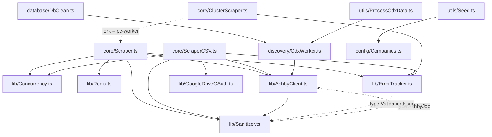

# 06 · Module Reference (file-by-file)

Base path: `/Users/pavanreddy/Documents/anti-gravity/job-scrapper`. Line numbers (`Lnn`) are the declaration line in the
tree as of 2026-10-22; every exported symbol of every module in `src/` and `scripts/` is listed. Symbols marked
*(private)* are module-internal or `private` class members.

## Dependency Graph (internal imports)

Every file that touches the DB creates its **own** `new PrismaClient()` at module scope (`Scraper`, `ClusterScraper`,
`ScraperCSV`, `CdxWorker`, `Seed`, `Verify`, `DbClean`, `DbInspect`, `DbMenu`).

---

## `../src/core/`

### [Scraper.ts](../src/core/Scraper.ts) — DB scraper (`npm run scrape`, cluster worker)
| Symbol | Line | Description |
|---|---|---|
| `CONCURRENCY_LIMIT = 15`, `BATCH_SIZE = 100` *(private)* | L26-27 | Default HTTP concurrency; jobs per DB write batch |
| `interface ProcessedJob` *(private)* | L29 | Sanitized row ready for `createMany`/upsert (incl. `salaryMin/Max/Currency`, `metadata`, `contentHash`) |
| `export class AshbyScraper` | L46 | Holds `departmentCache`/`locationCache` (name→id), `departmentInFlight`/`locationInFlight` (Promise dedupe), `notFoundStrikes`, `companiesWithExistingJobs`, `hasLoadedExistingJobSlugs`, `isRedisConnected` |
| `initRedis()` *(private)* | L59 | Connects Redis if status `wait`; sets `isRedisConnected` |
| `recordNotFoundStrike(slug, maxStrikes = 3)` | L75 | Increments in-memory strike count; on `>= maxStrikes` sets `Company.status = NOT_FOUND` (errors ignored); returns `true` if quarantined |
| `deactivateStaleJobs(slug, activeAshbyIds)` | L95 | `job.updateMany` → `active=false` for active jobs not in the live list; returns count (0 on error) |
| `fetchJobs(slug, maxNotFoundStrikes = 1)` *(private)* | L120 | Thin wrapper over `fetchAshbyBoardWithFallback` with strike handling; **not used by `runAll()`** (tests only) |
| `generateHash(job)` *(private)* | L148 | md5 of `title\|location\|department\|salary.min\|salary.max` |
| `getOrCreateDepartment(name)` *(private)* | L157 | Cache → in-flight Promise → `upsert`; on error `findUnique` recovery (P2002); `null` for empty name |
| `getOrCreateLocation(name)` *(private)* | L201 | Same as above for `Location` |
| `filterChangedJobs(jobs)` *(private)* | L245 | Per-job Redis `GET job:<id>:hash` compare; keeps all jobs when Redis is down |
| `batchUpsertJobs(jobs, tracker?)` *(private)* | L266 | Per 100: `findMany` + `createMany(skipDuplicates)` for new, `$transaction(upsert)` for changed/inactive; per-job fallback on error; Redis pipeline `SET … EX 604800` |
| `processCompanyJobs(slug, jobs)` *(private)* | L395 | Change filter → sanitize text/URL/metadata, resolve dept/location ids, `extractSalary` → `ProcessedJob[]` |
| `runAll({ slugs?, workerId?, concurrency?, saveTelemetry? })` | L440 | Orchestrator: pre-warm caches, adaptive limiter, streaming flush chain, telemetry; returns `ErrorReportDocument` |
| `require.main` guard | L594 | `--ipc-worker`: wait for one IPC message, run shard, reply `worker_done` / `worker_error`; otherwise `runAll()` |

### [ClusterScraper.ts](../src/core/ClusterScraper.ts) — Multi-process coordinator (`npm run scrape:parallel`)
| Symbol | Line | Description |
|---|---|---|
| `resolveWorkerCount(argv, totalItems, cpuCount = os.cpus().length)` | L18 | `--workers=N` (N ≥ 1) or default `min(4, max(2, cpuCount))`; capped at `totalItems` (min 1) |
| `partitionSlugs(slugs, workerCount)` | L35 | Round-robin shards; empty shards removed |
| `runWorkerShard(workerId, slugs, perWorkerConcurrency)` *(private)* | L49 | `fork(Scraper.ts, ['--ipc-worker'])` (adds `-r ts-node/register` if needed), sends `{ workerId, slugs, concurrency }`, resolves on `worker_done`; rejects on `worker_error`, child `error`, or `exit` before a message |
| `runClusterScrape(argv = process.argv)` | L101 | Loads ACTIVE slugs, per-worker concurrency `12` (>100 companies) else `max(5, ceil(20/shards))`, runs shards in parallel, `mergeReports` + `saveMergedReport`; returns merged report or `null` |
| `require.main` guard | L148 | Exit 1 on failure |

### [ScraperCSV.ts](../src/core/ScraperCSV.ts) — CSV scraper (`npm run scrape:csv`)
| Symbol | Line | Description |
|---|---|---|
| `CONCURRENCY_LIMIT = 15` *(private)* | L19 | Adaptive limiter start value |
| `interface JobRecord` | L21 | CSV row: `company, title, link, publishedDate, location, department` |
| `fetchJobsForCompany(slug, tracker?, onRateLimit?, onSuccess?)` | L33 | `fetchAshbyBoardWithFallback(includeCompensation=false)`, forwards telemetry/limiter callbacks, maps to sanitized `JobRecord[]` |
| `escapeCSV(value)` | L81 | Strips `\x00`; quotes + doubles `"` when value has `,` `"` `\n` `\r` |
| `formatCSVRow(job)` | L93 | 6-column escaped CSV line |
| `uploadToGoogleDrive(path)` *(private)* | L107 | Wraps service-account `uploadWithOAuth(path, GOOGLE_DRIVE_FOLDER_ID)` |
| `scrapeToCSV()` | L115 | Orchestrator: stream to `output/jobs_<date>.csv`, save `csv_scrape` telemetry, optional `--upload-cloud` |
| `require.main` guard | L221 | `scrapeToCSV().catch(console.error)` (exit code 0 on failure) |

## `../src/discovery/`

### [CdxWorker.ts](../src/discovery/CdxWorker.ts) — `npm run discover`
| Symbol | Line | Description |
|---|---|---|
| `CDX_API_URL`, `COMMON_CRAWL_INDEX_URL` *(private)* | L13-14 | `http://web.archive.org/cdx/search/cdx`; `https://index.commoncrawl.org/CC-MAIN-2024-51-index` |
| `VALID_SLUG_REGEX`, `BLOCKLIST` *(private)* | L20-22 | `^[a-z0-9]+(?:-[a-z0-9]+)*$`; blocklist: login, api, feed, jobs, careers, admin, dashboard, search, assets, static, fonts, css, js, favicon, robots.txt, null, undefined, true, false, 0x, 100vh, 500ms, void, embed, application, apply, graphql, non-user-graphql, posting-api, sitemap.xml, manifest.json, health, status, privacy, terms, oauth, auth, webhook, webhooks, internal, nan |
| `isValidSlug(slug)` | L34 | **Shared validator** (length 2–50, regex, blocklist, not all digits); used by DbClean, ProcessCdxData |
| `fetchAshbyUrls(limit = 1000)` *(private)* | L55 | Wayback CDX call; returns URL strings, `[]` on error |
| `fetchCommonCrawlUrls()` | L79 | CommonCrawl JSONL index call (15 s timeout); returns URL strings, `[]` on error |
| `extractCompanySlug(url)` | L112 | First path segment → decode, lowercase, strip quotes → `isValidSlug` or `null` |
| `enrichCompanyMetadata(slug)` | L139 | `fetchOrganizationMetadata` → `company.update({ name?, logoUrl? })`; returns success boolean |
| `runDiscovery({ includeCommonCrawl?, enrichMetadata? })` | L162 | Fetch URLs → unique slugs → sequential `company.upsert` (+ optional enrich) |
| `require.main` guard | L203 | Reads `--common-crawl`, `--enrich` |

## `../src/lib/`

### [AshbyClient.ts](../src/lib/AshbyClient.ts)
| Symbol | Line | Description |
|---|---|---|
| `BROWSER_HEADERS` | L13 | Chrome 131 `User-Agent`, `Accept`, `Accept-Language` to avoid WAF/bot 403s |
| `interface AshbyCompensationComponent` | L20 | `compensationType, interval?, currencyCode?, minValue?, maxValue?` |
| `interface AshbyJob` | L28 | Job shape (REST + GraphQL-mapped), incl. `compensation` and legacy `compensationTier` |
| `interface AshbyBoardFetchResult` | L54 | `{ slug, jobs, notFound, rateLimited?, source: 'rest'\|'graphql'\|'none', validationIssues? }` |
| `interface AshbyOrganizationMetadata` | L63 | `{ name?, logoUrl? }` |
| `GRAPHQL_URL`, `GRAPHQL_JOB_BOARD_QUERY` *(private)* | L68-70 | Hosted GraphQL endpoint and `ApiJobBoardWithTeams` query |
| `isRetryableError(error)` | L99 | `true` for HTTP 429/500/502/503/504 and `ECONNABORTED`/`ETIMEDOUT`/`ECONNRESET` |
| `extractSalary(job)` | L115 | `{ min, max, currency }` from `summaryComponents` → `compensationTiers` → legacy `compensationTier`, else `{}` |
| `fetchFromAshbyGraphQL(slug)` | L163 | POST to hosted GraphQL (10 s, no retry), maps postings/teams to `AshbyJob`, sanitizes; `{ boardExists, jobs }` |
| `fetchOrganizationMetadata(slug)` | L224 | GET hosted board HTML, parses `window.__appData.organization` → name + wordmark/square logo; `null` on failure |
| `fetchAshbyBoardWithFallback(slug, { includeCompensation = false, maxRetries = 2, baseDelayMs = 300 })` | L258 | REST GET (10 s) with backoff+jitter retries, `sanitizeJobBatch()`, GraphQL fallback on 404/403/400 |

### [Sanitizer.ts](../src/lib/Sanitizer.ts)
| Symbol | Line | Description |
|---|---|---|
| `interface ValidationIssue` | L9 | `{ companySlug, jobId, field, reason, action: 'filtered'\|'sanitized' }` |
| `interface SanitizeBatchResult` | L17 | `{ validJobs, issues }` |
| `INVALID_ID_VALUES`, `INVALID_ID_CHARS_REGEX`, `CONTROL_AND_NULL_REGEX`, `NULL_AND_SURROGATE_REGEX`, `HTML_ENTITIES` *(private)* | L23-32 | Placeholder ids (`null`, `undefined`, `nan`, `true`, `false`, `[object object]`); forbidden id chars (whitespace `< > ' " \ ? #`); control/null/lone-surrogate matchers; entity map |
| `decodeHtmlEntities(input)` | L46 | Decodes `&amp; &lt; &gt; &quot; &#39; &#x27; &apos; &nbsp;` |
| `sanitizeText(value)` | L56 | Non-string → `''`; control/null/surrogate → space; decode entities; collapse whitespace; trim |
| `sanitizeJobDescriptionHtml(html)` | L65 | Strips null/surrogates, `<script\|style\|iframe\|object\|embed>`, inline `on*=` handlers, neutralises `javascript:`/`vbscript:` `href`/`src`, replaces ≥1 KB base64 data URIs |
| `sanitizeJobDescriptionPlain(plain, fallbackHtml?)` | L85 | Uses plain text or tag-stripped sanitized HTML; removes control chars, normalises newlines |
| `sanitizeJobUrl(rawUrl, slug, jobId, isApplyUrl = false, onIssue?)` | L110 | Keeps valid `http(s)` (relative paths resolved against `https://jobs.ashbyhq.com`); otherwise canonical `https://jobs.ashbyhq.com/{slug}/{id}[/application]` and calls `onIssue` |
| `sanitizePublishedDate(rawDate)` | L156 | Leading `YYYY-MM-DD` if parseable, else `undefined` |
| `sanitizeJsonMetadata(value)` | L169 | Recursive JSON-safe copy: strips null/surrogates, non-finite numbers → `null`, drops `undefined`/functions/symbols, sanitizes nested `descriptionHtml`/`descriptionPlain` |
| `validateAndSanitizeJob(rawJob, slug, issues = [])` | L212 | Filters non-objects, bad ids (empty, >128 chars, placeholder, forbidden chars), empty/placeholder titles; sanitizes fields/URLs/metadata; `isRemote` also true when location contains "remote" |
| `sanitizeJobBatch(rawJobs, slug)` | L314 | Non-array → issue; filters duplicate ids; returns `{ validJobs, issues }` |

### [ErrorTracker.ts](../src/lib/ErrorTracker.ts)
| Symbol | Line | Description |
|---|---|---|
| `interface RecordedErrorEvent` | L11 | `{ timestamp, category: 'api_error'\|'graphql_fallback'\|'validation_issue'\|'db_error', companySlug, jobId?, field?, message, actionTaken, samplePayload? }` (`api_error` is currently never emitted) |
| `interface RunTelemetrySummary` | L22 | `runId, mode, startedAt, completedAt, durationSeconds` + 9 counters |
| `interface ErrorReportDocument` | L39 | `{ schemaVersion: '1.0', summary, events }` |
| `MAX_EVENTS_STORED = 500` *(private)* | L45 | Event cap (per tracker and per merged report) |
| `export class ErrorTracker(mode = 'db_scrape')` | L50 | Public counters: `companiesAttempted, companiesWithJobs, companiesNotFound, graphqlFallbacksUsed, rateLimitsEncountered, jobsCollected, jobsSanitized, jobsFilteredOut, dbErrors` |
| `recordEvent(event)` | L78 | Adds timestamped event unless cap reached |
| `recordValidationIssues(issues)` | L89 | `filtered` → `jobsFilteredOut++`, else `jobsSanitized++`; records a `validation_issue` event each |
| `buildReport()` | L111 | Builds `ErrorReportDocument` (`runId: run_<startMs>`) |
| `saveReport(outputDir = <cwd>/output)` | L138 | Writes `error-report_<YYYY-MM-DD>.json` + `latest-error-report.json`; returns latest path or `null` |
| `static mergeReports(reports, startedAtMs, mode = 'db_scrape')` | L162 | Sums counters across worker reports, concatenates events (≤500), `runId: cluster_run_<ms>` |
| `static saveMergedReport(report, outputDir?)` | L216 | Same file outputs as `saveReport` for a merged report |

### [Concurrency.ts](../src/lib/Concurrency.ts)
| Symbol | Line | Description |
|---|---|---|
| `interface AdaptiveLimiterOptions` | L7 | `minConcurrency?` (default 2), `recoveryThreshold?` (default 25), `defaultCooldownMs?` (default 2000) |
| `interface AdaptiveLimiter` | L13 | Callable `limit(fn)` plus `onRateLimit(cooldownMs?)`, `onSuccess()`, `getConcurrency()`, `getActiveCount()` |
| `createLimiter(concurrency, options?)` | L27 | p-limit-style queue (CommonJS-friendly); `onRateLimit` halves concurrency (≥ min) and pauses dispatch for the cooldown (timer `unref`'d); `onSuccess` +1 after N consecutive successes; task errors propagate to the caller |
| `chunk(array, size)` | L109 | Splits an array into fixed-size chunks — **unused** in `../src/` (tested only) |

### [Redis.ts](../src/lib/Redis.ts)
| Symbol | Line | Description |
|---|---|---|
| `redisUrl` *(private)* | L26 | `REDIS_URL` or `redis://localhost:6379` (module calls `dotenv.config()`) |
| `redis` | L52 | ioredis client, `lazyConnect: true`; `retryStrategy` returns `min(times*50, 2000)` ms (linear 50/100/150) and gives up after 3 retries |
| `error` handler | L80 | Silences `ECONNREFUSED`, logs other errors |

### [GoogleDriveOAuth.ts](../src/lib/GoogleDriveOAuth.ts) (service account)
| Symbol | Line | Description |
|---|---|---|
| `SCOPES`, `CREDENTIALS_PATH` *(private)* | L12-13 | `…/auth/drive`; `apikeys/google-credentials.json` |
| `authorize()` *(private)* | L18 | JWT auth from credentials file; `null` (with setup help) if missing |
| `uploadWithOAuth(filePath, folderId?)` | L49 | `files.create` as `text/csv`, `supportsAllDrives`; returns link or `null` (quota hint on failure); throws if JWT `authorize()` fails |
| `listFiles()` | L107 | Logs first 10 files (debug) |

### [GoogleDriveUserOAuth.ts](../src/lib/GoogleDriveUserOAuth.ts) (user OAuth2)
| Symbol | Line | Description |
|---|---|---|
| `SCOPES`, `CREDENTIALS_PATH`, `TOKEN_PATH` *(private)* | L21-23 | `…/auth/drive.file`; `apikeys/oauth-credentials.json`; `apikeys/oauth-token.json` |
| `getAuthenticatedClient()` *(private)* | L28 | Loads creds/token, refreshes expired token, else starts consent |
| `getNewToken(client)` *(private)* | L79 | Terminal consent flow (interactive; unsuitable for unattended cron on first run) |
| `askQuestion(q)` *(private)* | L110 | readline prompt helper |
| `uploadWithUserOAuth(filePath, folderId?)` | L128 | Upload owned by the user; MIME by extension |
| `listUserFiles()` | L183 | Logs 10 most recently modified files with owner |

## `../src/database/`

### [DbMenu.ts](../src/database/DbMenu.ts) — `npm run db:menu`
No exports; **runs on import** (L244-245). *(private)* `MENU` (L16), `showDashboard` (L34), `showJobsPerCompany` (L51, top 15),
`showTopSalaries` (L70, top 10), `searchJobs` (L97, 10 rows, case-insensitive), `showLocations` (L133, top 10),
`showGhostCompanies` (L161), `runSqlQuery` (L184, `$queryRawUnsafe`, 50 rows shown), `prompt` (L214, menu loop, option 8 exits).

### [DbInspect.ts](../src/database/DbInspect.ts) — `npm run db:inspect`
No exports; **runs on import** (L66). *(private)* `inspectDatabase()` (L14) — `information_schema` tables/columns + `COUNT(*)` (skips `_`-prefixed tables).

### [DbClean.ts](../src/database/DbClean.ts) — `npm run db:clean`
| Symbol | Line | Description |
|---|---|---|
| `cleanDatabase()` | L15 | Finds companies failing `isValidSlug`; dry-run unless `--execute`, then deletes their jobs, then the companies |
| `require.main` guard | L76 | Safe to import |

## `../src/utils/`

| File | Symbol | Line | Description |
|---|---|---|---|
| [Seed.ts](../src/utils/Seed.ts) | `loadTargetSlugs(useExtractedFile = false)` | L17 | `extracted-slugs.json` (cwd) when flag set and file is an array, else `TARGET_COMPANIES` |
| | `seed({ useExtractedSlugs? })` | L33 | Memory diff vs existing slugs, then `company.createMany({ status: 'ACTIVE' }, skipDuplicates)` |
| | `require.main` guard | L70 | Reads `--all` |
| [ProcessCdxData.ts](../src/utils/ProcessCdxData.ts) | `processRawCDXData(rows)` (exported at L131) | L17 | Filters raw CDX rows to valid slugs, prints `TARGET_COMPANIES` block, writes `extracted-slugs.json`, returns sorted slugs |
| | `inputFile` *(private)* | L11 | `process.argv[2]`, read at module load |
| | `require.main` guard | L119 | Reads/parses the input file, or prints usage |
| [Verify.ts](../src/utils/Verify.ts) | `interface DbVerificationReport` | L11 | 12 count/integrity fields |
| | `verifyDatabase()` | L29 | Table/status counts, top-15 companies, 500-job integrity sample, top-5 USD salaries → report |
| | `require.main` guard | L132 | Exit 1 on error |

## `../src/config/`

- [Companies.ts](../src/config/Companies.ts) — `TARGET_COMPANIES: string[]` (L10): `deel`, `remote`, `reddit`, `multiverse`, `1password`, `abridge`, `go-augment` (`go-augment` exercises the GraphQL fallback). Note: at time of analysis `remote` returned 404 and `deel`/`reddit` returned 0 jobs from Ashby.

## `../scripts/`

| File | Symbol | Line | Description |
|---|---|---|---|
| [GenerateDocs.ts](../scripts/GenerateDocs.ts) (`npm run docs:generate`) | `FunctionDoc`, `FileDoc` *(private interfaces)* | L10-16 | Parsed doc shapes |
| | `getFileIcon(path)` | L27 | Icon/colour by path keyword |
| | `EXCLUDED_DIRS` | L46 | `node_modules, dist, .git, docs, output, .vscode, apikeys` |
| | `discoverFiles(dir)` | L49 | Recursive `.ts` (non-`.d.ts`) / `.prisma` file finder |
| | `parseJSDoc(content)` | L85 | File `@file/@summary/@tags` + function-level summaries |
| | `parsePrismaSchema(content)` | L177 | Models + fields |
| | `generateHTML(docs)` / `generateTreeHTML(docs)` | L225 / L423 | Builds the explorer page and file tree |
| | `main()` | L491 | Writes `backend/docs/project-explorer.html`; **runs on import** (L545), no exports |
| [generate-readme.ts](../scripts/generate-readme.ts) (no npm script) | `interface JobRow` | L10 | Parsed CSV row |
| | `sanitizeMarkdownCell(text)` | L22 | Newlines → space, `\|` → `\\|` (backslash-escaped pipe) |
| | `parseCSV(content)` | L32 | Quote-aware CSV parser (skips header/blank lines) |
| | `generateMarkdownTable(jobs)` | L78 | `JOBS.md` table with truncation and safe links |
| | `main()` *(private)* | L109 | Newest `output/jobs_*.csv` → `JOBS.md`; `require.main` guard L141 |

## Coding Conventions

- PascalCase file names for modules (`Scraper.ts`, `DbMenu.ts`); kebab-case for some scripts (`generate-readme.ts`).
- Every file starts with a JSDoc block: `@file`, `@summary`, `@tags` (consumed by `GenerateDocs.ts`). Exception:
  `GoogleDriveUserOAuth.ts` has no `@tags`, and its functions (and `processRawCDXData`) lack `@summary`.
- Every function/method/class gets a JSDoc `@summary` (ESLint `jsdoc/require-jsdoc` warns otherwise; ESLint only lints `src/`).
- Emoji-rich console logging; no logging library.
- `any` is allowed (`@typescript-eslint/no-explicit-any: off`); unused vars prefixed `_` are ignored.
