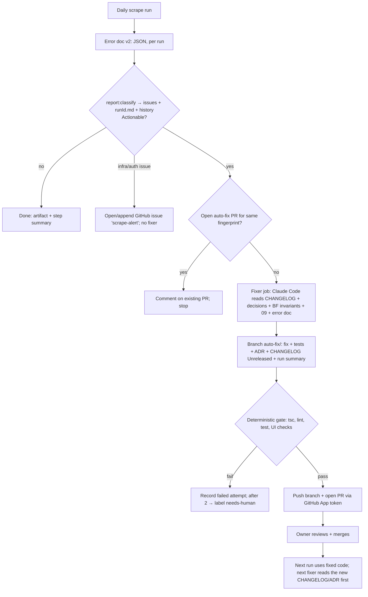

# 16 · The Self-Healing Fix Loop Protocol

This document defines the complete protocol for diagnosing, fixing, testing, documenting, and opening PRs for errors reported during automated scrapes and CI operations.

Every human engineer and AI agent (`scraper-bugfixer`) must follow this exact sequence.

---

## 1. Overview & Architecture



---

## 2. Actionable Issue Classification

Reports are classified by `src/lib/ReportClassifier.ts` against the telemetry rules. Only actionable issues (`severity === 'S1'` or `'S2'`) trigger the bug-fixing workflow.

| Rule ID | Condition | Severity / Outcome |
|---|---|---|
| R-CACHE-1 | `cache_publish_failed` ≥ 1 (gated or error) for 2 consecutive runs | Actionable S1 |
| R-STALE-1 | `consecutiveEmptyBoards` ≥ 2 (quarantined or deactivation confirmed) | Actionable S2 |
| R-API-1 | `api_error` rate > 5% of attempted companies | Actionable S2 |
| R-RATE-1 | `rate_limited` rate > 10% of attempted companies | Actionable S2 |
| R-CO-1 | `company_error` ≥ 1 or `company_unreachable` ≥ 1 | Actionable S2 |
| R-RECUR-1 | Fingerprint already has open PR | Comment on that PR; stop |
| R-STOP-1 | `fixAttempts` ≥ 2 on open `fix-failed` issue | Stop fixer; label `needs-human` |
| R-REGRESS-1 | `status === 'regressed'` | Actionable S1, handled first |

---

## 3. The 9-Step Fixer Protocol

Every bugfix must be executed in this strict 9-step order:

1. **Read history:**
   - Inspect `CHANGELOG.md` (`[Unreleased]` and the last 2 releases).
   - Inspect `docs/decisions/README.md` and read any ADR whose BF or GAP IDs match the issue.
2. **Read the guards:**
   - Inspect the BF invariants in `docs/bug-fix-log.md`.
   - Check guard status in `docs/testing.md` §6.
   - Review open debt in `backend/docs/known-issues.md`.
3. **Read the error doc:**
   - Read the issues list in `output/reports/<YYYY-MM>/<runId>.issues.json` in exact priority order.
   - Read the full error report `output/reports/<YYYY-MM>/<runId>.json` when additional event context or payload data is required.
4. **Plan:**
   - Identify the exact root cause (`path:line`), proposed fix, regression test strategy, and affected BF invariant.
   - Skip any issue whose fix would violate an established invariant, and note the conflict clearly.
5. **Fix and test:**
   - Write the failing Regression test first (TDD).
   - Implement the minimal fix in code.
   - Verify the regression test transitions from failing to passing.
6. **Record:**
   - Add a `BF-XXX` entry in `docs/bug-fix-log.md`.
   - Update `backend/docs/known-issues.md` status if resolving an open debt item.
   - Write an Architecture Decision Record in `docs/decisions/ADR-XXXX-*.md` if an architectural choice or invariant changed.
   - Add an entry under `[Unreleased]` in `CHANGELOG.md`.
   - Write run documentation in `docs/runs/<runId>.md`.
   - Regenerate the project explorer via `npm run docs:generate`.
7. **Verify:**
   - Run the mandatory verification suite:
     ```bash
     npx tsc --noEmit -p . && npx tsc --noEmit -p tsconfig.test.json && npm run lint && npm test && npm run verify:ui
     ```
8. **Commit:**
   - Commit changes to branch `auto-fix/<runId>` using Conventional Commits with a bulleted body detailing symptom, root cause, code changes, tests, and documentation.
9. **CI:**
   - The deterministic CI step (via GitHub App token) pushes the branch and opens a Pull Request using the PR body template below. The fixer agent itself never pushes; no agent ever pushes to or merges into `main` (interactive agents may publish other branches only via `scripts/agents/push-branch.sh`, ADR-0017).

---

## 4. PR Body Template

Pull Requests created by the fixer workflow follow this structure:

```markdown
## Summary
Fixes automated scrape issue from run `<runId>`.

<!-- fp:<fingerprint-hash> -->

### Triage & Classification
- **Issue Rule:** <rule-id> (<severity>)
- **Component:** <component-name>
- **Fingerprint:** `<fingerprint-hash>`

### Root Cause & Changes
- **Root Cause:** <description with file:line>
- **Fix:** <summary of code modification>
- **Invariant Guard:** <BF-XXX invariant preserved or updated>

### Verification
- **Regression test:** <path-to-test>
- **Verification Commands:**
  - `npx tsc --noEmit -p . && npx tsc --noEmit -p tsconfig.test.json` (0 errors)
  - `npm run lint` (0 errors)
  - `npm test` (all suites pass)
  - `npm run verify:ui` (clean)
- **Docs:** CHANGELOG.md, ADR-XXXX, doc 10 updated.
```

---

## Appendix: Cold-Start Test Verification (AG-11)

- **Date:** 2026-10-24
- **Git SHA:** HEAD (`56c9199`)
- **Evaluated Tools:** Claude Code (12/12) and Google Antigravity (12/12)
- **Result:** 100% Pass (24/24 total across both environments)

### Test Questions & Verified Canon Truth
1. **Three runtime parts connection:** Web UI (`frontend/`) queries `/v1/*` routed by Vercel (`api/index.ts` -> `Server.ts`). API reads Upstash Redis (`jc:v1:*`) read-through with Neon PostgreSQL fail-safe. Scraper (`scrape:parallel` on daily Actions) writes PostgreSQL then publishes cache generations.
2. **Scheduled scrape command & workers:** `npm run scrape:parallel -- --workers=4` at 06:17 UTC via `.github/workflows/scrape-daily.yml`. Default concurrency `min(4, max(2, cpus))`.
3. **Job change detection:** Deterministic `contentHash` over 16 explicit core fields + metadata compared in PostgreSQL; `createMany` for new jobs, upsert for modifications, zero Redis queries in scrape loop.
4. **Redis data contents & writers:** `jc:v1:active_gen`, `jc:v1:gen:<gen>`, `jc:v1:details:<0..7>` sharded by CRC32(id) % 8, `jc:v1:details:index`, `jc:v1:meta:*`, `jc:v1:lock:publish`. Scraper/publisher is the sole writer. API only reads.
5. **Error report location & schema:** `output/reports/<YYYY-MM>/<runId>.json` (v2.0 schema) containing `run`, `summary`, `workers`, `categories`, `issues`, `diffVsPrevious`, `events`.
6. **Worker process crash handling:** Coordinator uses `Promise.allSettled()` and watchdog timers. Process saves report, skips cache publication, exits 1, and old cache generation continues serving.
7. **Company quarantine rules:** Quarantined to `NOT_FOUND` after 3 consecutive confirmed 404s, deactivating jobs; rechecked on Sundays. Fetch failures alone never deactivate; 7 consecutive failures trigger actionable `company_unreachable`.
8. **Available REST endpoints:** `/health`, `/v1/jobs`, `/v1/jobs/:id`, `/v1/facets`, `/v1/companies`, `/v1/meta`. Page size ≤ 100. Emits `X-Cache` CDN and read-through telemetry headers.
9. **Rate limiting architecture:** Vercel WAF rule of 120 req / 60 s / IP on `/v1/`; per-instance `dbGuard` limiting active queries to 3 with queue of 10 and 503 backpressure; client-side rate gate removed.
10. **Forbidden targets & Git permissions:** Never read/stage/commit `.env`, `apikeys/`, or `output/` values. The CI fixer works on `auto-fix/*` and commits only; the deterministic CI step pushes and opens PRs. Interactive agents may publish task branches only via `scripts/agents/push-branch.sh` (fast-forward, never `main`). Never push to `main`, never merge.
11. **Actionable issues workflow:** Scrape triggers fixer job (`claude-code-action` on Claude Code). Reads `CHANGELOG.md`, `docs/decisions/`, doc 10 + 11 §6, doc 09, and error doc. Fixes at most 3 issues with tests, updates BF registry, ADR, CHANGELOG, and creates PR.
12. **Mandatory verification gate:** `npx tsc --noEmit -p . && npx tsc --noEmit -p tsconfig.test.json && npm run lint && npm test && npm run verify:ui && npm run docs:generate`.
