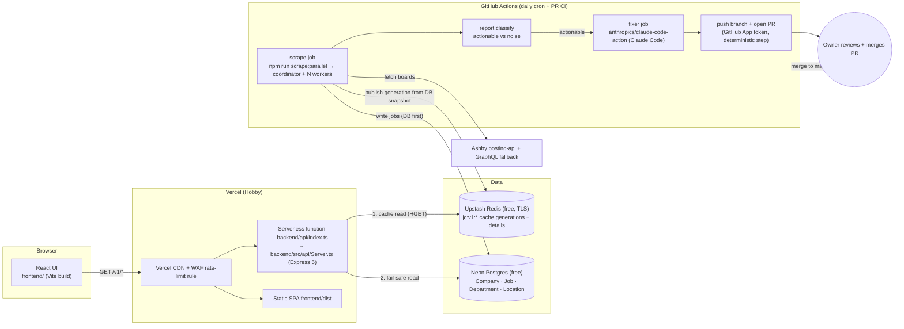
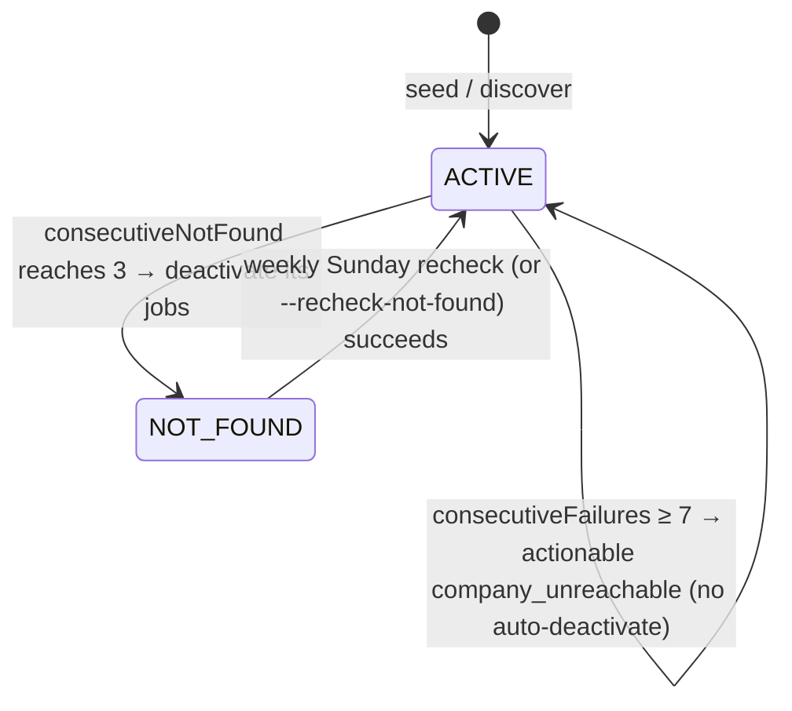
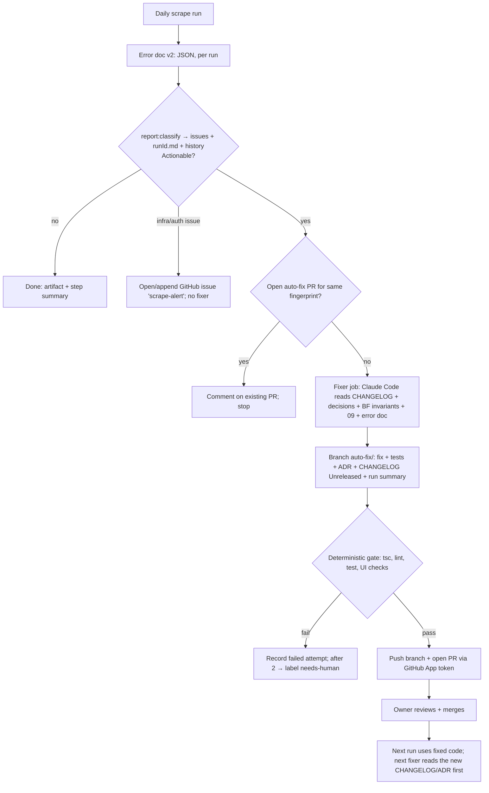

# 15 · System Architecture & Flows

> Canonical reference for component diagrams, sequence flows, and state machines across the Ashby Job Scraper ecosystem.

---

## 1. System Component Architecture



---

## 2. Write-Path Sequence (Scheduled Scrape Run)

```mermaid
sequenceDiagram
  autonumber
  participant Cron as GH Actions cron (06:17 UTC)
  participant Co as ClusterScraper (coordinator)
  participant W as Workers ×4 (--ipc-worker)
  participant A as Ashby
  participant PG as Neon Postgres
  participant P as Publisher (backend/src/cache/Publisher.ts)
  participant R as Upstash Redis
  participant ET as ErrorTracker v2
  Cron->>Co: npm run scrape:parallel -- --workers=4
  Co->>PG: load ACTIVE companies (+ NOT_FOUND on Sundays)
  Co->>W: fork + shard (round-robin)
  loop each company (isolated try/catch)
    W->>A: GET posting-api (retry/backoff) → GraphQL fallback on 404/403/400
    W->>PG: createMany new / upsert changed+inactive / deactivate missing (contentHash compare, no Redis)
    W->>PG: update Company counters (consecutiveNotFound/Failures, lastSuccessAt)
  end
  W-->>Co: IPC report (counters, events)
  Co->>Co: Promise.allSettled + watchdog → merge reports
  alt all workers ok
    Co->>P: publishCacheGeneration({runId, scrapeFinishedAt, prisma, redis})
    P->>R: SET jc:v1:lock:publish NX
    P->>PG: snapshot active+listed jobs (LIST_SELECT, no metadata) + facets + companies
    P->>P: sanity gate vs meta:lastPublish (gated → SET meta:lastScrapeAt only, stop, exit 2)
    P->>R: HSET jc:v1:details:<crc32(id)%8> new/changed details + jc:v1:details:index
    P->>R: HSET jc:v1:gen:<gen> pages/facets/companies/meta … then __manifest LAST; verify HLEN
    P->>R: MULTI: SET current, PERSIST new gen, SET meta:lastScrapeAt + meta:lastPublish, EXPIRE old gen 900 → EXEC
    P->>R: HDEL removed ids from details shards + index
  else a worker failed
    Note over Co,R: no publish, lastScrapeAt not updated (old generation stays live)
  end
  Co->>ET: save output/reports/<YYYY-MM>/<runId>.json (+ latest-*.json)
  Note over Co,ET: then `npm run report:classify` adds issues/diff to the JSON and writes <runId>.md
  Co-->>Cron: exit 0 (ok) | 1 (hard failure) | 2 (scrape ok, publish failed or gated)
```

---

## 3. Read-Path Sequence (API Request Flow)

```mermaid
sequenceDiagram
  autonumber
  participant B as Browser (UI)
  participant C as Vercel CDN
  participant F as API function
  participant L as In-process LRU (30 s)
  participant R as Upstash Redis
  participant PG as Neon Postgres
  B->>C: GET /v1/jobs?page=2&workplaceType=Remote
  alt CDN fresh (s-maxage 300)
    C-->>B: 200 (cached at edge)
  else
    C->>F: forward
    F->>F: canonicalJobsKey(query) → "jobs?page=2&workplaceType=Remote"; isCacheableView? (no → MISS → Postgres, no Redis)
    F->>R: MGET jc:v1:current jc:v1:meta:lastScrapeAt (only if not cached in-process; 300 s)
    F->>R: HGET jc:v1:gen:<gen> __manifest (only once per gen per instance)
    F->>L: lookup "<gen>|<key>"
    alt LRU hit
      L-->>F: body
    else
      F->>R: HGET jc:v1:gen:<gen> "jobs?page=2&workplaceType=Remote"
      alt HIT
        R-->>F: gzip body
        F-->>C: 200 X-Cache: HIT (or STALE if snapshot old)
      else MISS (view/page not cached, field missing)
        F->>PG: same query via backend/src/api/db/queries.ts
        F-->>C: 200 X-Cache: MISS + reason
      else Redis down / timeout / breaker open / budget exceeded
        F->>PG: query
        F-->>C: 200 X-Cache: BYPASS + reason
      end
    end
  end
  Note over F,PG: Postgres down → 503 {code: UPSTREAM_UNAVAILABLE, retryAfterSeconds: 5}
```

---

## 4. Job Lifecycle State Machine

```mermaid
stateDiagram-v2
  [*] --> Active: first seen (createMany)
  Active --> Active: unchanged (contentHash equal → no write)
  Active --> Active: changed (upsert; nullable columns cleared with null)
  Active --> Inactive: missing from a successful board fetch
  Active --> Inactive: company quarantined (3 consecutive confirmed 404s)
  Active --> PendingEmpty: board returns 0 jobs but company had ≥5 active (P1-T13)
  PendingEmpty --> Inactive: still empty next run
  PendingEmpty --> Active: jobs back
  Inactive --> Active: job reappears (contentHash compare sees active=false → upsert active=true)
```



---

## 5. Company Lifecycle State Machine



---

## 6. Self-Healing Fix Loop



Full details and the 9-step workflow are documented in [`documentation/16-self-healing-loop.md`](./16-self-healing-loop.md).

---

## 7. Agent Routing Table

Agents coordinate work according to specialized domains defined in [`documentation/agents/roster.md`](./agents/roster.md):

| Role | Scope / Allowed Paths | Primary Responsibilities |
|---|---|---|
| `scraper-architect` | Read-only across codebase; writes `documentation/plan/**`, ADRs | System design, architectural evolution, and performance modeling |
| `run-reviewer` | `output/reports/**`, `documentation/runs/**` | Triaging scrape run telemetry, distinguishing noise from actionable S1/S2 regressions |
| `scraper-bugfixer` | `src/lib/**`, `src/core/**`, `src/database/**`, `tests/**`, `documentation/decisions/**`, `CHANGELOG.md` | Diagnosing root causes, implementing bug fixes, and authoring regression invariant guards |
| `api-cache` | `src/api/**`, `src/cache/**`, `api/**`, `vercel.json`, `tests/unit/{ApiServer,ReadThrough,Breaker}*` | Express API, Upstash Redis caching, circuit breakers, rate limits, edge CDN headers |
| `frontend` | `frontend/**` | React 19 UI, Redux Toolkit, accessibility, search UX, and Tailwind styling |
| `docs-release-keeper` | `documentation/**`, `CHANGELOG.md`, `README.md`, `AGENTS.md` | Maintaining documentation sync, release changelogs, agent prompts, and explorer tools |

---

## 8. Cross-Component Invariants

| Invariant | Owner | Guarding Test |
|---|---|---|
| Postgres is written before cache; cache is built only from verified DB snapshot. | scraper / publisher | `tests/unit/Publisher.test.ts` |
| `jc:v1:active_gen` is flipped only after generation manifest is written & sanity drop check passes (< 30%). | publisher | `tests/unit/Publisher.test.ts` |
| Cache errors never fail API requests; API falls back to Postgres with `X-Cache: BYPASS`. | API / ReadThrough | `tests/unit/ReadThrough.test.ts` |
| Payload schema and ordering are byte-identical whether served from cache or Postgres. | API + publisher | `src/api/contract.ts`, `tests/unit/ReadThrough.test.ts` |
| `salaryInterval` is ignored unless `salaryMin` or `salaryMax` is specified. | API + UI | `tests/unit/ApiServer.test.ts` |
| List queries never select `metadata`. | API / queries | `src/api/db/queries.ts` |
| Agents never push to `main` and never merge. Only CI deterministic steps push feature/fix branches. | fixer workflow | `scripts/ci/check-fixer-scope.sh` |
| Agent instructions have one canonical copy; tool shells point to it. | docs-release-keeper | `tests/unit/AgentShells.test.ts` |

---

## 9. Failure-Mode Matrix

| Failure Mode | Scraper Behavior | API Behavior | User Experience | Alert Mechanism |
|---|---|---|---|---|
| **Upstream 5xx on Ashby** | Exponential backoff, fallback to GraphQL, record `api_error` | Unaffected | Jobs from prior scrape remain available | Actionable only if failure rate > 5% |
| **Worker process crash / timeout** | Watchdog terminates with SIGTERM, partial report saved, exit 1, no publish | Serves previous active cache generation | Uninterrupted browsing | GitHub Issue `scrape-alert` + fixer job |
| **Cache publication failure** | Exit 2; DB is updated; old cache generation remains active | Serves previous active cache generation | Uninterrupted browsing | Actionable after 2 consecutive failures |
| **Upstash Redis outage / archived** | Publication fails (exit 2) | Circuit breaker opens; reads bypass to PostgreSQL | Normal latency (< 150 ms) | `/health` indicates `cache.state=unreachable` |
| **Redis command budget exhausted** | Publication skipped | Circuit breaker opens; reads bypass to PostgreSQL | Normal latency | `/health` reports `budget_exhausted` |
| **Neon PostgreSQL outage** | Scrape halts (exit 1) | Cache HITs succeed; cache MISSes return 503 | Cached pages work; uncached pages 503 | GitHub Issue `scrape-alert` |
| **Fixer cannot fix issue** | Test gate fails; attempts counter incremented | Unaffected | Unaffected | `needs-human` label applied on 2nd failure |

---

## 10. Architectural Glossary

| Term | Definition |
|---|---|
| **Double-Buffered Generation** | Two alternating cache key spaces (`gen:A` and `gen:B`) swapped atomically via pointer key `jc:v1:active_gen`. |
| **Sanity Gate** | Publisher safety check preventing cache swap if active job count drops by > 30% without explicit override. |
| **Detail Shards** | 8 hash-partitioned Redis keys (`jc:v1:details:<0..7>`) storing full job description payloads, indexed via CRC32. |
| **Circuit Breaker** | API fail-safe tracking Redis errors/timeouts; opens after 3 consecutive failures to route directly to DB. |
| **DbGuard** | Serverless Express middleware limiting concurrent database queries to 3 with queue depth of 10 and 503 backpressure. |
| **Error Fingerprint** | Deterministic SHA-256 hash identifying recurring scrape error categories, fields, and company targets. |

