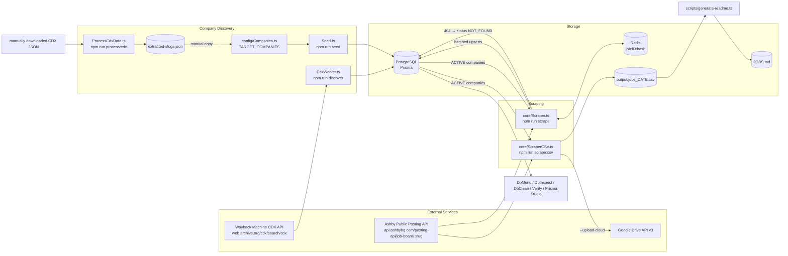
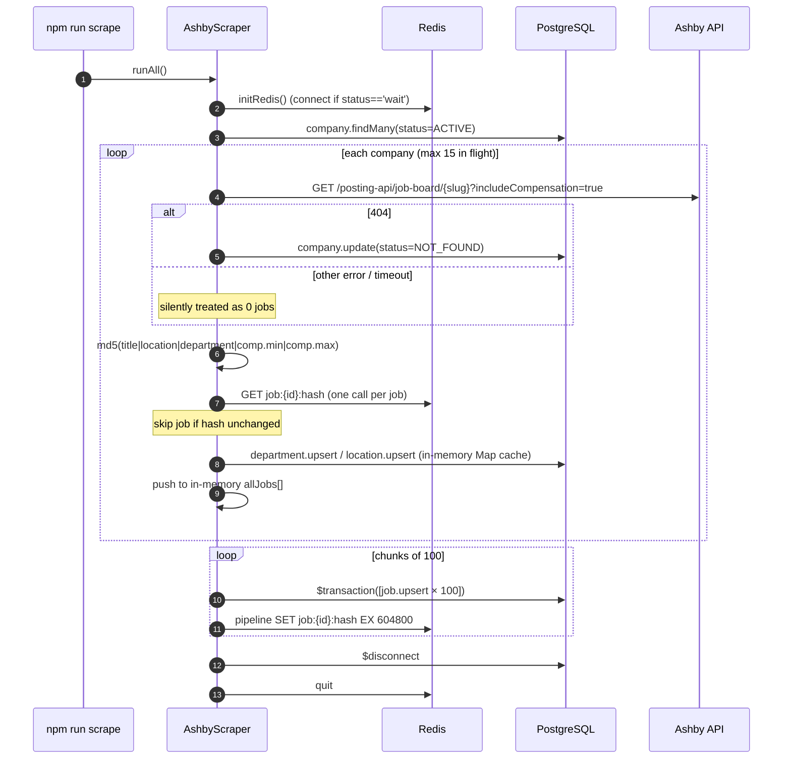

# 02 · Architecture & Workflows

## 1. High-Level Architecture



**Key idea:** the `Company` table is the *work queue*. Both scrapers start with
`prisma.company.findMany({ where: { status: 'ACTIVE' } })`. So even the "CSV-only" scraper **requires a working
`DATABASE_URL`**.

---

## 2. Workflow A — Company Discovery (two alternative paths)

### A1. Automatic: `npm run discover` → [CdxWorker.ts](file:///Users/pavanreddy/Documents/anti-gravity/job-scrapper/src/discovery/CdxWorker.ts)

1. `GET http://web.archive.org/cdx/search/cdx?url=jobs.ashbyhq.com/*&output=json&fl=original&collapse=urlkey&limit=1000`
   - ⚠️ `limit: 1000` is hard-coded ("for testing") → only the first 1000 archived URLs are seen.
2. Drop the header row; for each URL take the **first path segment**, `decodeURIComponent`, lowercase, strip quotes.
3. Validate with `isValidSlug()` (length 2–50, regex `^[a-z0-9]+(?:-[a-z0-9]+)*$`, not in blocklist, not purely numeric).
4. Deduplicate in a `Set`; then `prisma.company.upsert` **one by one** (`create: { slug, name: slug }`, `update: {}`).
   Prints a `.` per slug.

### A2. Manual / bulk: download CDX JSON → `npm run process:cdx -- <file.json>` → edit config → `npm run seed`

1. User downloads the full CDX JSON (array-of-arrays) manually from the Wayback CDX endpoint (no limit).
2. [ProcessCdxData.ts](file:///Users/pavanreddy/Documents/anti-gravity/job-scrapper/src/utils/ProcessCdxData.ts) applies stricter
   filters (rejects `.well-known`, `$`/`%` prefixes, wildcards, pure numbers, UUIDs, ≥20-char hex, CSS units, < 2 chars)
   then `isValidSlug()`.
3. Prints a ready-to-paste `export const TARGET_COMPANIES = [...]` block and writes **`extracted-slugs.json`** (sorted).
4. User pastes slugs into [Companies.ts](file:///Users/pavanreddy/Documents/anti-gravity/job-scrapper/src/config/Companies.ts)
   (currently only `deel, remote, reddit, multiverse`, so the ~3k list was used once and then reverted).
5. [Seed.ts](file:///Users/pavanreddy/Documents/anti-gravity/job-scrapper/src/utils/Seed.ts): loads all existing slugs (1 query),
   diffs in memory, `createMany({ skipDuplicates: true })` for new ones with `status: ACTIVE` (1 query).

> This manual path is evidently how the DB reached ~3k companies (matches `extracted-slugs.json` size and CSV company count).

---

## 3. Workflow B — Scrape to Database: `npm run scrape`

File: [Scraper.ts](file:///Users/pavanreddy/Documents/anti-gravity/job-scrapper/src/core/Scraper.ts) — class `AshbyScraper`, entry `runAll()`.



**Important behaviours**
- **Concurrency:** `CONCURRENCY_LIMIT = 15` using the home-grown `createLimiter`.
- **Write strategy:** *all* changed jobs for *all* companies are accumulated in memory, then written at the end in
  transactions of `BATCH_SIZE = 100`. A crash mid-run means nothing is persisted for that run.
- **Change detection:** Redis key `job:<ashbyId>:hash`, TTL 7 days. Without Redis, every job is upserted every run.
- **Upsert semantics:** `create` sets all fields; `update` only refreshes `title, departmentId, locationId, salaryMin,
  salaryMax, contentHash, updatedAt, active=true` (does **not** update `metadata`, `applyUrl`, `salaryCurrency`).
- **No deactivation:** jobs that disappear from Ashby are never set `active=false`.
- **Status lifecycle:** only `ACTIVE → NOT_FOUND` (on HTTP 404). `REDIRECTED` is defined but never used; nothing
  reactivates a company.

---

## 4. Workflow C — Scrape to CSV: `npm run scrape:csv [-- --upload-cloud]`

File: [ScraperCSV.ts](file:///Users/pavanreddy/Documents/anti-gravity/job-scrapper/src/core/ScraperCSV.ts).

1. `--upload-cloud` flag read from `process.argv`.
2. Load `ACTIVE` companies from DB. If none → prints "Run: npm run seed" and exits.
3. Ensure `output/`, open write stream `output/jobs_<UTC YYYY-MM-DD>.csv` (overwrites same-day file), write header.
4. For each company (15 concurrent): `GET /posting-api/job-board/{slug}` (**no** `includeCompensation`).
   Map each job → `{company, title, link: https://jobs.ashbyhq.com/{slug}/{id}, publishedDate: publishedAt[0..10], location, department}`.
   Rows are **streamed immediately** in completion order (not sorted). Any error → `[]` (404s are *not* recorded in DB).
5. Close stream, disconnect Prisma. If 0 jobs → delete the empty file.
6. If `--upload-cloud`: `uploadWithOAuth(filePath, GOOGLE_DRIVE_FOLDER_ID)` from `GoogleDriveOAuth.ts`
   (**service-account JWT**, Drive scope, `supportsAllDrives: true`).

---

## 5. Workflow D — Publish `JOBS.md`

`npx ts-node scripts/generate-readme.ts` (no npm script):
1. Find newest `output/jobs_*.csv` (lexicographic sort works because of ISO date names).
2. Naive CSV parse (quote toggling; doesn't handle `""` escaped quotes or multi-line fields).
3. Write `JOBS.md` at repo root: header with date + total, then a table `# | Company | Job Title | Location | Department | Posted | Apply`
   with truncation (title 40, company/location 20, department 15 chars).

---

## 6. Workflow E — Database Maintenance & Inspection

| Command | What happens |
|---|---|
| `npm run db:menu` | Interactive loop (options 1–8): dashboard counts, top-15 companies by jobs, top-10 salaries, title search (case-insensitive, 10 rows), top-10 locations, "ghost" companies (0 jobs), **raw SQL via `$queryRawUnsafe`** (shows 50 rows), exit |
| `npm run db:inspect` | Lists `public` tables, columns (type/nullable) and row counts from `information_schema` |
| `npm run db:clean` | Dry-run by default; finds companies failing `isValidSlug`. With `-- --execute` deletes their jobs first (FK), then the companies |
| `npm run verify` | Prints counts of companies, jobs, departments |
| `npm run prisma:studio` | Prisma Studio GUI |

---

## 7. Workflow F — Docs Generation: `npm run docs:generate`

[GenerateDocs.ts](file:///Users/pavanreddy/Documents/anti-gravity/job-scrapper/scripts/GenerateDocs.ts) walks the repo (excluding
`node_modules, dist, .git, docs, output, .vscode, apikeys`), parses JSDoc `@file / @summary / @tags` blocks and function
signatures, parses `schema.prisma` models, and emits a single self-contained `docs/project-explorer.html` with a file tree.
This is why ESLint enforces JSDoc (`jsdoc/require-jsdoc`, custom tags allowed).

---

## 8. Recommended Operational Sequence

```bash
npm install && npx prisma generate && npx prisma db push   # one-time
npm run seed            # or: npm run discover / process:cdx path
npm run scrape          # DB snapshot (needs Redis for efficiency)
npm run scrape:csv -- --upload-cloud                        # daily CSV + Drive
npx ts-node scripts/generate-readme.ts                      # refresh JOBS.md
npm run db:menu         # explore
```
