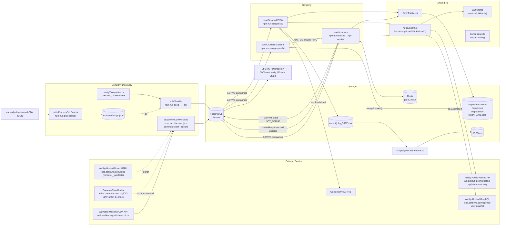

# 02 · Architecture & Workflows

> Verified line-by-line against `src/` and `scripts/` on 2026-10-22. Every constant below is cited to the file that
> defines it; if you change one in code, change it here too.

## 1. High-Level Architecture



**Key idea:** the `Company` table is the *work queue*. All three scrapers start with
`prisma.company.findMany({ where: { status: 'ACTIVE' }, select: { slug: true } })` (`src/core/Scraper.ts`,
`src/core/ClusterScraper.ts`, `src/core/ScraperCSV.ts`). So even the "CSV-only" scraper **requires a working
`DATABASE_URL`**.

**Shared fetch path:** every Ashby board request — DB, cluster and CSV — goes through
`fetchAshbyBoardWithFallback()` in `src/lib/AshbyClient.ts` (see [03-external-apis.md](./03-external-apis.md) §1–2b),
which always runs `sanitizeJobBatch()` (`src/lib/Sanitizer.ts`) on the REST response before returning.

---

## 2. Workflow A — Company Discovery (two alternative paths)

<a id="workflow-a1"></a>

### A1. Automatic: `npm run discover [-- --common-crawl] [-- --enrich]` → [CdxWorker.ts](file:///Users/pavanreddy/Documents/anti-gravity/job-scrapper/src/discovery/CdxWorker.ts)

Entry: `runDiscovery({ includeCommonCrawl, enrichMetadata })`. Flags are read from `process.argv` inside the
`require.main` guard (`--common-crawl` → `includeCommonCrawl`, `--enrich` → `enrichMetadata`).

1. `fetchAshbyUrls(limit = 1000)` (private):
   `GET http://web.archive.org/cdx/search/cdx?url=jobs.ashbyhq.com/*&output=json&fl=original&collapse=urlkey&limit=1000`
   (no timeout set). Drops the header row (`response.data.slice(1)`), returns column 0. On error: logs and returns `[]`.
   - ⚠️ `limit` defaults to `1000` and `runDiscovery()` never overrides it → only the first 1000 archived URLs are seen.
2. If `--common-crawl`: `fetchCommonCrawlUrls()` →
   `GET https://index.commoncrawl.org/CC-MAIN-2024-51-index?url=jobs.ashbyhq.com/*&output=json&fl=url` (`timeout: 15000`).
   The body is **JSONL**; each line is `JSON.parse`d and its `url` taken. Any error → `[]`. URLs are appended to the CDX list.
3. `extractCompanySlug(url)`: first path segment → `decodeURIComponent` → lowercase → strip `"`/`'` → `isValidSlug()`.
4. `isValidSlug()`: length 2–50, regex `^[a-z0-9]+(?:-[a-z0-9]+)*$`, not in `BLOCKLIST`, not purely numeric.
5. Deduplicate in a `Set`; then **sequentially** `prisma.company.upsert({ where: { slug }, update: {}, create: { slug, name: slug } })`
   (status defaults to `ACTIVE` in the schema). Prints a `.` per slug; a failed upsert logs `Failed to upsert <slug>`.
6. If `--enrich`: right after each upsert, `enrichCompanyMetadata(slug)` → `fetchOrganizationMetadata(slug)`
   (`GET https://jobs.ashbyhq.com/<slug>` HTML, parse `window.__appData.organization`) → `company.update` with `name`
   and/or `logoUrl`. Runs for **every** discovered slug, including ones already in the DB. Returns `false` on any failure.
7. `prisma.$disconnect()`; exit code 1 on an uncaught error.

### A2. Manual / bulk: download CDX JSON → `npm run process:cdx -- <file.json>` → `npm run seed -- --all`

1. User downloads the full CDX JSON (array-of-arrays) manually from the Wayback CDX endpoint (no limit).
2. [ProcessCdxData.ts](file:///Users/pavanreddy/Documents/anti-gravity/job-scrapper/src/utils/ProcessCdxData.ts)
   `processRawCDXData(rows)` skips the `original` header row and bare `https://jobs.ashbyhq.com/` roots, then rejects
   `.well-known*`, `$`/`%` prefixes, wildcards (`*`), pure numbers, UUIDs, ≥20-char hex strings, CSS units
   (`px|em|rem|vh|vw|ms|s|%`), and < 2 chars, before finally applying `isValidSlug()`. Unparseable URLs are silently skipped.
3. Prints a ready-to-paste `export const TARGET_COMPANIES = [...]` block and writes **`extracted-slugs.json`** (sorted)
   in the current working directory. With no file argument it only prints usage.
4. [Seed.ts](file:///Users/pavanreddy/Documents/anti-gravity/job-scrapper/src/utils/Seed.ts) `seed({ useExtractedSlugs })`:
   - `loadTargetSlugs(useExtractedFile)` — with `--all`, reads `<cwd>/extracted-slugs.json` if it exists and is an array;
     otherwise (or without `--all`) returns `TARGET_COMPANIES` from
     [Companies.ts](file:///Users/pavanreddy/Documents/anti-gravity/job-scrapper/src/config/Companies.ts)
     (currently 7 slugs: `deel, remote, reddit, multiverse, 1password, abridge, go-augment`).
   - Loads all existing slugs (1 query), diffs in memory, then `company.createMany({ data: [{ slug, name: slug, status: 'ACTIVE' }], skipDuplicates: true })`
     for new ones (1 query). Skips the insert entirely when nothing is new.

> This manual path is how the DB reached ~3,072 companies (matches `extracted-slugs.json` size).

---

## 3. Workflow B — Scrape to Database: `npm run scrape`

File: [Scraper.ts](file:///Users/pavanreddy/Documents/anti-gravity/job-scrapper/src/core/Scraper.ts) — class `AshbyScraper`, entry `runAll(options?)`.

```mermaid
sequenceDiagram
    autonumber
    participant CLI as npm run scrape
    participant S as AshbyScraper
    participant R as Redis
    participant DB as PostgreSQL
    participant AC as AshbyClient
    participant A as Ashby REST / GraphQL

    CLI->>S: runAll()
    S->>R: initRedis() (connect if status=='wait')
    S->>DB: department.findMany / location.findMany (pre-warm caches)
    S->>DB: job.findMany(active, distinct companySlug) → companiesWithExistingJobs
    S->>DB: company.findMany(status=ACTIVE)  (skipped when options.slugs given)
    loop each company (adaptive limiter, start 15 in flight)
        S->>AC: fetchAshbyBoardWithFallback(slug, includeCompensation=true)
        AC->>A: GET /posting-api/job-board/{slug}?includeCompensation=true (≤3 attempts)
        alt REST 404/403/400
            AC->>A: POST /api/non-user-graphql?op=ApiJobBoardWithTeams
        end
        AC-->>S: { jobs, notFound, rateLimited, source, validationIssues }
        alt rateLimited
            S->>S: limit.onRateLimit() (halve concurrency, pause 2s)
        else
            S->>S: limit.onSuccess()
        end
        alt notFound (REST 404 and GraphQL had no board)
            S->>S: recordNotFoundStrike(slug, 3)
            Note over S,DB: company.update(status=NOT_FOUND) only on 3rd strike
        else source rest|graphql
            S->>DB: deactivateStaleJobs(slug, liveIds) (only if company had active jobs)
        else source none (retries exhausted / non-board error)
            Note over S: treated as 0 jobs, no telemetry event
        end
        S->>S: md5(title|location|department|salary.min|salary.max)
        S->>R: GET job:{id}:hash (one call per job, only if Redis connected)
        Note over S: skip job if hash unchanged
        S->>DB: getOrCreateDepartment / getOrCreateLocation (cache + in-flight dedupe)
        S->>S: push to pendingJobs[]; every 100 → chain batchUpsertJobs()
    end
    S->>S: final flush of remaining pendingJobs
    loop each 100-job batch
        S->>DB: job.findMany(ashbyId in batch)
        S->>DB: job.createMany(new, skipDuplicates) + $transaction(upsert changed/inactive)
        Note over S,DB: on error → per-job upsert fallback, db_error event
        S->>R: pipeline SET job:{id}:hash EX 604800
    end
    S->>S: ErrorTracker.saveReport() → output/latest-error-report.json
    S->>DB: $disconnect
    S->>R: quit (if ready)
```

**Important behaviours**
- **Concurrency:** `CONCURRENCY_LIMIT = 15` (`src/core/Scraper.ts`), overridable via `runAll({ concurrency })`. Uses the
  adaptive `createLimiter()` (`src/lib/Concurrency.ts`): `onRateLimit()` halves concurrency (floor `minConcurrency = 2`)
  and pauses dispatch for `defaultCooldownMs = 2000`; `onSuccess()` adds +1 after `recoveryThreshold = 25` consecutive
  successes, up to the original max. A board counts as "rate-limited" if **any** REST attempt returned `429` **or `403`**.
- **Fetch & fallback:** `fetchAshbyBoardWithFallback()` (`src/lib/AshbyClient.ts`): `maxRetries = 2` (3 attempts total),
  `baseDelayMs = 300`, delay `300·2^attempt + rand(0–99)` ms (≈300 ms, ≈600 ms), axios `timeout: 10000`, `BROWSER_HEADERS`.
  Retries only `isRetryableError()` cases (`429`, `500`, `502`, `503`, `504`, `ECONNABORTED`, `ETIMEDOUT`, `ECONNRESET`).
  After the loop, a final `404`/`403`/`400` triggers `fetchFromAshbyGraphQL()`; `notFound: true` is returned **only** for
  `404` with no GraphQL board. Every other failure returns `{ jobs: [], notFound: false, source: 'none' }`.
- **Cache pre-warming (BF-010):** at start, all `Department` and `Location` rows are loaded into `departmentCache` /
  `locationCache`, and the distinct `companySlug`s of active jobs into `companiesWithExistingJobs`.
- **Write strategy:** Incremental streaming — `processCompanyJobs()` output is appended to `pendingJobs`; whenever ≥
  `BATCH_SIZE = 100` accumulate, a chunk is chained onto a single serial `flushChain` Promise (writes never run in
  parallel with each other, but do overlap HTTP fetching). Remaining jobs are flushed after all fetches finish.
- **`batchUpsertJobs()` fast path (BF-010):** per 100-job batch: one `job.findMany({ ashbyId in batch })`; new IDs go to
  `job.createMany({ skipDuplicates: true })`; existing IDs are upserted in a `$transaction` **only** if `contentHash`
  differs or the row is `active=false`. If `findMany`/`createMany` are unavailable it falls back to `$transaction` of
  upserts for the whole batch. On **any** batch error it retries each job with an individual `job.upsert` (BF-004),
  counting failures in `tracker.dbErrors` with a `db_error` event (`actionTaken: skipped_corrupt_job_in_fallback`).
- **Change detection:** Redis key `job:<ashbyId>:hash`, TTL 7 days (`60*60*24*7` s), written via pipeline only for jobs
  that were stored successfully. Without Redis every job is processed every run (and the bulk path still skips unchanged
  rows via `contentHash`).
- **Upsert semantics:** `create` sets `ashbyId, title, companySlug, departmentId, locationId, applyUrl, salaryMin,
  salaryMax, salaryCurrency, metadata, contentHash, active=true`; `update` sets the same minus `ashbyId`/`companySlug`
  plus `updatedAt: new Date()`.
- **Per-job processing (`processCompanyJobs()`):** skips jobs with empty sanitized title or missing id; sanitizes
  department/location via `sanitizeText()`, `applyUrl` via `sanitizeJobUrl(..., isApplyUrl=true)`, the whole raw job via
  `sanitizeJsonMetadata()` → `metadata`; salary via `extractSalary()`.
- **Stale job deactivation:** `deactivateStaleJobs(slug, ids)` → `job.updateMany({ companySlug, active: true, ashbyId notIn ids }, { active: false })`
  after every successful (`rest`/`graphql`) fetch — but only for companies in `companiesWithExistingJobs` (or for all
  companies if that pre-load failed). Errors return `0`.
- **3-strike quarantine:** `recordNotFoundStrike(slug, 3)` increments an **in-memory, per-`AshbyScraper`-instance** counter
  and sets `Company.status = NOT_FOUND` on the 3rd strike (errors ignored). A successful fetch clears the counter. Note that
  `runAll()` fetches each company once, so see [09-known-issues](./09-known-issues-and-tech-debt.md) on whether the
  threshold is reachable within one run. The private `fetchJobs()` helper (used by unit tests, not by `runAll()`) uses
  `maxNotFoundStrikes = 1`, i.e. immediate quarantine.
- **Department/Location race safety:** `getOrCreateDepartment()` / `getOrCreateLocation()` check the resolved cache, then
  an in-flight Promise map (`departmentInFlight` / `locationInFlight`), then `upsert`; on an upsert error (e.g.
  cross-process `P2002`) they recover via `findUnique({ where: { name } })` before rethrowing.
- **Telemetry:** an `ErrorTracker('db_scrape')` counts `companiesAttempted`, `companiesWithJobs`, `companiesNotFound`,
  `graphqlFallbacksUsed` (+ `graphql_fallback` event), `rateLimitsEncountered`, `jobsCollected`, validation issues and
  `dbErrors`. `saveTelemetry` defaults to `true` unless `workerId` is set; when true, `saveReport()` writes
  `output/latest-error-report.json` and `output/error-report_<YYYY-MM-DD>.json`. `runAll()` returns the
  `ErrorReportDocument`.
- **Logging:** per-company `✅` lines only when ≤ 50 companies; progress line every 50 companies.

---

## 4. Workflow B2 — Multi-Process Scrape: `npm run scrape:parallel [-- --workers=N]`

File: [ClusterScraper.ts](file:///Users/pavanreddy/Documents/anti-gravity/job-scrapper/src/core/ClusterScraper.ts), entry `runClusterScrape(argv)`.

1. Query `ACTIVE` companies, then `prisma.$disconnect()` (the coordinator never touches the DB again). If none → prints
   "Run: npm run seed" and returns `null`.
2. `resolveWorkerCount(argv, slugs.length)`: default `min(4, max(2, os.cpus().length))` (i.e. 2–4); `--workers=N` (N ≥ 1)
   overrides it; result is capped at the number of companies. The documented 34k-job / 141.3 s run used `--workers=8`.
3. `partitionSlugs(slugs, workerCount)`: round-robin (`slug[i] → shard[i % count]`), empty shards dropped.
4. Per-worker HTTP concurrency: `12` if more than 100 companies, else `max(5, ceil(20 / shards))`.
5. `runWorkerShard(workerId, slugs, concurrency)` for every shard in parallel:
   `child_process.fork(src/core/Scraper.ts, ['--ipc-worker'], { execArgv, stdio: ['inherit','inherit','inherit','ipc'] })`.
   `execArgv` reuses the parent's when it already contains `ts-node`, otherwise appends `-r ts-node/register`.
6. **IPC protocol:**
   - parent → child (once): `{ workerId, slugs, concurrency }`.
   - child (`Scraper.ts --ipc-worker`, `process.once('message')`) runs `runAll({ slugs, workerId, concurrency, saveTelemetry: false })`, then sends
     `{ type: 'worker_done', workerId, report: ErrorReportDocument }` and exits `0`, or on error
     `{ type: 'worker_error', workerId, error: string }` and exits `1`.
   - parent rejects on `worker_error`, a child `error` event, or an `exit` before any message
     (`Worker #N exited unexpectedly with code X`).
7. `Promise.all` of all shards (⚠️ one failing worker rejects the whole run and no merged report is written), then
   `ErrorTracker.mergeReports(reports, startedAtMs, 'db_scrape')` (sums all counters, concatenates events up to 500,
   `runId: cluster_run_<ms>`) and `ErrorTracker.saveMergedReport()` → `output/latest-error-report.json` + dated copy.
8. Each worker has its own `PrismaClient`, Redis connection, caches, limiter and strike map.

---

## 5. Workflow C — Scrape to CSV: `npm run scrape:csv [-- --upload-cloud]`

File: [ScraperCSV.ts](file:///Users/pavanreddy/Documents/anti-gravity/job-scrapper/src/core/ScraperCSV.ts), entry `scrapeToCSV()`.

1. `--upload-cloud` flag read from `process.argv`.
2. Load `ACTIVE` companies from DB. If none → prints "Run: npm run seed", disconnects and returns.
3. Ensure `output/`, open write stream `output/jobs_<UTC YYYY-MM-DD>.csv` (overwrites a same-day file), write header
   `Company,Job Title,Job Link,Published Date,Location,Department`.
4. For each company (adaptive `createLimiter(15)`; `CONCURRENCY_LIMIT = 15`): `fetchJobsForCompany(slug, tracker, onRateLimit, onSuccess)`
   calls `fetchAshbyBoardWithFallback(slug, { includeCompensation: false })` and forwards `rateLimited`,
   `graphql` fallbacks, `notFound` and `validationIssues` to the `ErrorTracker('csv_scrape')` (BF-009). Each job maps to
   a `JobRecord`: `company = sanitizeText(slug)`, `title`, `link = sanitizeJobUrl(jobUrl, slug, id, false)`,
   `publishedDate = sanitizePublishedDate(publishedAt) || ''`, `location`, `department`.
   Rows are **streamed immediately** in completion order via `formatCSVRow()` / `escapeCSV()` (strips `\x00`, quotes
   values containing `,` `"` `\n` `\r`). Progress line every 100 companies.
5. `tracker.saveReport(outputDir)` → `output/latest-error-report.json` (+ dated copy), then close the stream and
   disconnect Prisma. If 0 jobs → delete the empty CSV and return.
6. If `--upload-cloud`: `uploadWithOAuth(filePath, process.env.GOOGLE_DRIVE_FOLDER_ID)` from `src/lib/GoogleDriveOAuth.ts`
   (**service-account JWT**, `drive` scope, `supportsAllDrives: true`). No DB writes and no `NOT_FOUND` marking happen in
   this workflow.

---

## 6. Workflow D — Publish `JOBS.md`

`npx ts-node scripts/generate-readme.ts` (no npm script):
1. Find newest `output/jobs_*.csv` (lexicographic sort works because of ISO date names); exit 1 if none.
2. Quote-aware CSV parse (`parseCSV()` normalises `\r\n`/`\r`, handles `""` escaped quotes and commas in quotes, skips blank lines and the header).
3. Write `JOBS.md` at repo root via `generateMarkdownTable()`: header with date + total, then a table
   `# | Company | Job Title | Location | Department | Posted | Apply` with `sanitizeMarkdownCell()` escaping `|` and
   newlines, truncation (title 40, company/location 20, department 15 chars; longer values are cut and suffixed with `...`), and `)`/whitespace in links URL-encoded.

---

## 7. Workflow E — Database Maintenance & Inspection

| Command | What happens |
|---|---|
| `npm run db:menu` | `src/database/DbMenu.ts`. Interactive `readline` loop (options 1–8): dashboard counts (Company/Job/Department/Location), top-15 companies by jobs, top-10 salaries, title search (case-insensitive, 10 rows), top-10 locations, "ghost" companies (0 jobs, first 20 shown), **raw SQL via `$queryRawUnsafe`** (shows 50 rows), exit. Runs on import. |
| `npm run db:inspect` | `src/database/DbInspect.ts`. Lists `public` tables (skipping `_`-prefixed), columns (type/nullable) and `COUNT(*)` from `information_schema`. Runs on import. |
| `npm run db:clean` | `src/database/DbClean.ts` `cleanDatabase()`. Dry-run by default; finds companies failing `isValidSlug`, shows 15 samples. With `-- --execute` deletes their jobs first (`job.deleteMany` by `companySlug`), then the companies (`company.deleteMany` by `id`). Has `require.main` guard. |
| `npm run verify` | `src/utils/Verify.ts` `verifyDatabase()`. Counts Companies (total/ACTIVE/NOT_FOUND), Jobs (total/active/inactive/with salary), Departments, Locations; top-15 companies by job count; audits a 500-job sample for empty titles, non-`http(s)` `applyUrl`, and `\u0000` in `metadata`; prints top-5 USD salaries; returns a `DbVerificationReport`. Exit 1 on error. |
| `npm run prisma:studio` | Prisma Studio GUI |

---

## 8. Workflow F — Docs Generation: `npm run docs:generate`

[GenerateDocs.ts](file:///Users/pavanreddy/Documents/anti-gravity/job-scrapper/scripts/GenerateDocs.ts) recursively walks the
repo root (`discoverFiles()`, excluding directories named `node_modules, dist, .git, docs, output, .vscode, apikeys`) and
collects every `.ts` (not `.d.ts`) and `.prisma` file — this includes `tests/`, `__mocks__/` and `scripts/`.
`parseJSDoc()` reads the `@file` block at the very top of the file (`@summary` overrides `@file`, `@tags` comma-split)
and every later JSDoc block that is **immediately** followed (only whitespace in between; the regex is anchored on a
200-char look-ahead window) by a function/method signature (`@summary`, else first non-tag line; blocks with an
empty summary and duplicate names are dropped). `parsePrismaSchema()` extracts models and fields. `generateHTML()` + `generateTreeHTML()` emit
a single self-contained `docs/project-explorer.html`. This is why ESLint nudges for JSDoc (`jsdoc/require-jsdoc` at
`"warn"` level, custom tags allowed) — it does not fail on missing `@file`/`@summary`/`@tags`; the convention is enforced by review only (09 #44).

---

## 9. Recommended Operational Sequence

```bash
npm install && npx prisma generate && npx prisma db push   # one-time
npm run seed -- --all   # or: npm run seed (TARGET_COMPANIES) / npm run discover [-- --common-crawl --enrich]
npm run scrape:parallel -- --workers=8                      # DB snapshot across 8 OS processes (or: npm run scrape)
npm run verify                                              # integrity audit
npm run scrape:csv -- --upload-cloud                        # daily CSV + Drive
npx ts-node scripts/generate-readme.ts                      # refresh JOBS.md
npm run db:menu                                             # explore
```
