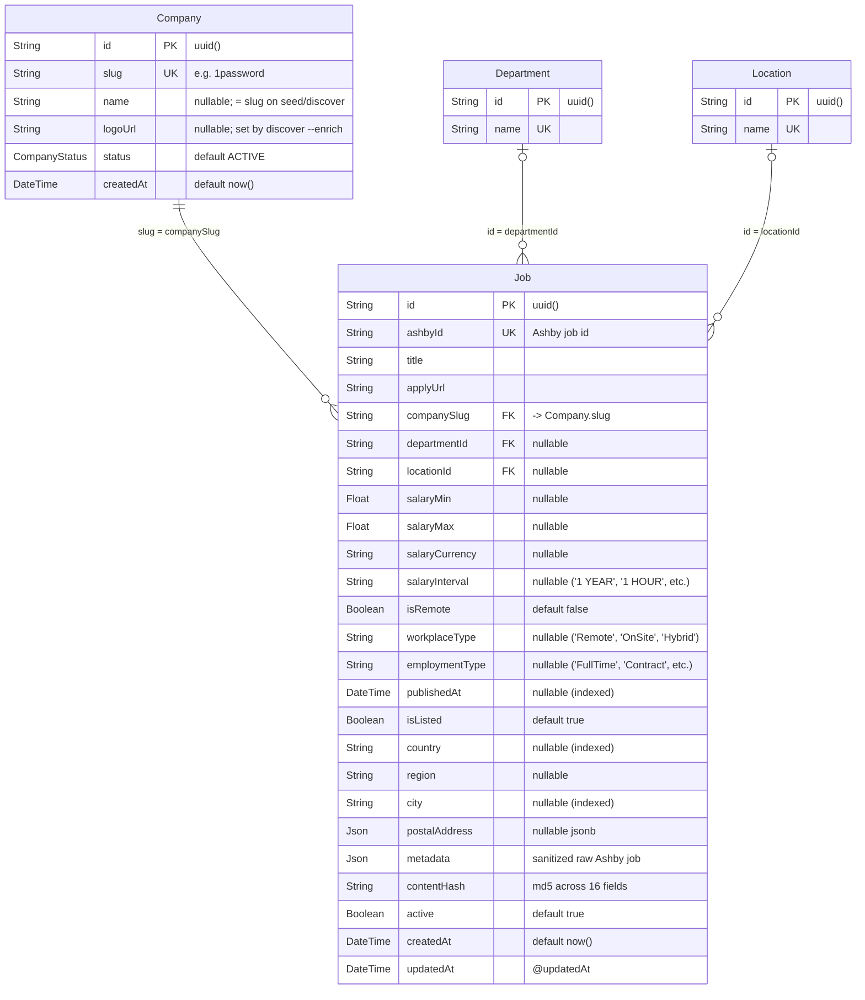

# 05 · Database & Cache

Schema file: [prisma/schema.prisma](file:///Users/pavanreddy/Documents/anti-gravity/job-scrapper/prisma/schema.prisma) ·
Provider: **PostgreSQL** (`url = env("DATABASE_URL")`) · Generator: `prisma-client-js` (Prisma 5.22) ·
Sync method: `npx prisma db push` (no `prisma/migrations/` folder).

Postgres object names are exactly the Prisma names (PascalCase, must be double-quoted in raw SQL): tables `"Company"`,
`"Department"`, `"Location"`, `"Job"`; enum type `"CompanyStatus"`.

## 1. ER Diagram



## 2. Models (exact field list from `schema.prisma`)

### `enum CompanyStatus`
| Value | Set by | Meaning |
|---|---|---|
| `ACTIVE` | `@default`, `Seed.ts` (`createMany`) | Scraped by `scrape`, `scrape:parallel`, `scrape:csv` (all filter `status = 'ACTIVE'`) |
| `NOT_FOUND` | `AshbyScraper.recordNotFoundStrike()` in `Scraper.ts` | Excluded from future scrapes; no automatic recovery |
| `REDIRECTED` | — (never written) | Reserved |

> ⚠️ **Strike counter is in-memory and per run.** `runAll()` calls `recordNotFoundStrike(slug, 3)` when Ashby returns
> `404` *and* the GraphQL fallback finds no board. The strike `Map` is reset every process start and each company is
> fetched once per run, so in practice the threshold of 3 is never reached and `NOT_FOUND` is not written by normal
> `scrape` / `scrape:parallel` runs (only by direct calls such as the private `fetchJobs(slug, 1)` helper, which `runAll`
> does not use). `tracker.companiesNotFound` in the telemetry still counts these 404s.

### `Company`
| Field | Type | Attributes |
|---|---|---|
| `id` | `String` | `@id @default(uuid())` |
| `slug` | `String` | `@unique` — natural key; FK target of `Job.companySlug`; Ashby path param |
| `name` | `String?` | `= slug` on seed / discover; real name via `npm run discover -- --enrich` |
| `logoUrl` | `String?` | set only by `--enrich` (`theme.logoWordmarkImageUrl` → `theme.logoSquareImageUrl`) |
| `status` | `CompanyStatus` | `@default(ACTIVE)` |
| `jobs` | `Job[]` | back-relation |
| `createdAt` | `DateTime` | `@default(now())` |

No `updatedAt` on `Company`.

### `Department` / `Location`
| Field | Type | Attributes |
|---|---|---|
| `id` | `String` | `@id @default(uuid())` |
| `name` | `String` | `@unique` (sanitized string from Ashby, e.g. `"Engineering"`, `"Remote"`, `"London, UK"`) |
| `jobs` | `Job[]` | back-relation |

No timestamps. Rows are only created by `Scraper.ts` (`getOrCreateDepartment/Location`): startup pre-warm of all rows into
an in-memory `Map`, in-flight `Promise` de-duplication, `upsert({ where: { name }, update: {}, create: { name } })`, and a
`findUnique` fallback that recovers from cross-process `P2002` unique-constraint races during `npm run scrape:parallel`.
Empty names (`""`) are not stored → `departmentId`/`locationId = null`.

### `Job`
| Field | Type | Attributes / notes |
|---|---|---|
| `id` | `String` | `@id @default(uuid())` |
| `ashbyId` | `String` | `@unique` — upsert key |
| `title` | `String` | `sanitizeText(job.title)`; jobs with empty title or id are skipped |
| `applyUrl` | `String` | `sanitizeJobUrl(job.applyUrl, slug, id, true)` → fallback `https://jobs.ashbyhq.com/{slug}/{id}/application` |
| `companySlug` | `String` | FK → `Company.slug` (relation `company`) |
| `departmentId` | `String?` | FK → `Department.id` (relation `department`) |
| `locationId` | `String?` | FK → `Location.id` (relation `location`) |
| `salaryMin` / `salaryMax` | `Float?` | from `extractSalary()` |
| `salaryCurrency` | `String?` | from `extractSalary()` (`currencyCode`) |
| `salaryInterval` | `String?` | from `extractSalary()` (`interval`: `'1 YEAR'`, `'1 HOUR'`, `'1 MONTH'`, etc.) |
| `isRemote` | `Boolean` | `@default(false)` — from `job.isRemote` or sanitized remote detection |
| `workplaceType` | `String?` | `'Remote'`, `'OnSite'`, `'Hybrid'` (from Ashby `workplaceType`) |
| `employmentType` | `String?` | `'FullTime'`, `'Contract'`, `'PartTime'`, `'Intern'`, `'Temporary'` |
| `publishedAt` | `DateTime?` | when the job was published (99.94% coverage; indexed) |
| `isListed` | `Boolean` | `@default(true)` — `false` means reachable only by direct link |
| `country` | `String?` | ISO-3166-1 alpha-2 2-letter uppercase code normalized from `job.address.postalAddress.addressCountry` via `toIsoCountry()` (indexed; `null` if unresolvable) |
| `region` | `String?` | State/region code from `addressRegion` |
| `city` | `String?` | Locality from `addressLocality` (indexed) |
| `postalAddress` | `Json?` | Full normalized postal address object |
| `metadata` | `Json` (Postgres `jsonb`) | `sanitizeJsonMetadata(job)` — whole sanitized Ashby job object |
| `contentHash` | `String` | `md5` across 16 fields (`title`, `location`, `department`, `salary.min`, `salary.max`, `salary.currency`, `salary.interval`, `isRemote`, `workplaceType`, `employmentType`, `publishedAt`, `applyUrl`, `isListed`, `country`, `region`, `city`) |
| `active` | `Boolean` | `@default(true)`; `true` on every create/update, `false` via `deactivateStaleJobs()` |
| `createdAt` | `DateTime` | `@default(now())` |
| `updatedAt` | `DateTime` | `@updatedAt` (also set explicitly to `new Date()` on update) |

**Indexes:** unique `ashbyId`; composite indexes:
- `@@index([active, isListed, publishedAt(sort: Desc), createdAt(sort: Desc), id])` (accelerates default filtered & sorted query)
- `@@index([active, isListed, workplaceType, publishedAt(sort: Desc)])`
- `@@index([active, isListed, employmentType, publishedAt(sort: Desc)])`
- `@@index([active, isListed, country, publishedAt(sort: Desc)])`
- `@@index([companySlug, active])` (replaces superseded `@@index([companySlug])`)
- `@@index([active, lastSeenAt])` (accelerates stale job deactivation)
- Single-column indexes preserved: `@@index([departmentId])`, `@@index([locationId])`, `@@index([isRemote])`, `@@index([city])`.
(Plus unique indexes on `Company.slug`, `Department.name`, `Location.name`.)

**Relations / referential actions:** none declared, so Prisma defaults apply — `Job.company` (required):
`onDelete: Restrict`; `Job.department` / `Job.location` (optional): `onDelete: SetNull`; all `onUpdate: Cascade`.
Deleting a `Company` therefore requires deleting its jobs first (done in `DbClean.ts`).

### Write paths for `Job` (in `Scraper.ts` → `batchUpsertJobs()`)
1. Jobs are buffered and flushed in chunks of `BATCH_SIZE = 100` through a serialized promise chain.
2. **Fast path:** `job.findMany({ ashbyId in batch })` → new IDs go to one `job.createMany({ skipDuplicates: true })`;
   existing rows are upserted in a `$transaction` **only** if `contentHash` differs or `active = false`. Unchanged rows
   are not written (DB-side change detection, works even without Redis).
3. If the Prisma client lacks `findMany`/`createMany` (e.g. some test mocks) → `$transaction` of upserts for the whole batch.
4. If the batch throws → per-job `upsert` fallback; failures are logged as `db_error` events and skipped.
5. `deactivateStaleJobs(slug, liveIds)`: `job.updateMany({ companySlug, active: true, ashbyId notIn liveIds } → active=false)`
   after every successful REST/GraphQL fetch, but only for companies that had active jobs at start-up (pre-loaded via
   `findMany({ where: { active: true }, distinct: ['companySlug'] })`). Not run when the fetch failed (`source: 'none'`).

## 3. API → DB Field Mapping (in `Scraper.ts` & `AshbyClient.ts`)

| Ashby field | DB column | Notes |
|---|---|---|
| `id` | `Job.ashbyId` | |
| `title` | `Job.title` | sanitized; updated on change |
| `applyUrl` | `Job.applyUrl` | sanitized / canonical fallback; updated on change |
| `department` | `Department.name` → `Job.departmentId` | GraphQL fallback: team name via `teamId` |
| `location` | `Location.name` → `Job.locationId` | GraphQL fallback: `locationName` |
| `compensation.summaryComponents[]` (`compensationType: 'Salary'`) → `compensation.compensationTiers[].components[]` → legacy `compensationTier` | `salaryMin/Max/Currency` | `extractSalary()`; REST is called with `?includeCompensation=true`. GraphQL fallback only returns `compensationTierSummary` (text) → salary columns stay `null` |
| *(entire sanitized object)* | `Job.metadata` | updated on change |
| — | `Job.companySlug` | from the company being scraped |

`ScraperCSV.ts` never writes to the DB (it only reads `Company` slugs).

## 4. Redis Cache

Client: [src/lib/Redis.ts](file:///Users/pavanreddy/Documents/anti-gravity/job-scrapper/src/lib/Redis.ts) (shared `ioredis` singleton; also calls `dotenv.config()`).

| Setting | Value |
|---|---|
| URL | `process.env.REDIS_URL` or fallback `redis://localhost:6379` (supports `rediss://`, e.g. Upstash) |
| `lazyConnect` | `true` — `AshbyScraper.initRedis()` calls `redis.connect()` once per process; on failure the cache is disabled for the run |
| Retry | `retryStrategy`: `times * 50` ms (50/100/150 ms), gives up after 3 retries with `Redis connection failed. Disabling cache for this run.` |
| Errors | `ECONNREFUSED` silenced; other errors logged as `Redis Error:` |
| Shutdown | `redis.quit()` at the end of `scrape` / each `--ipc-worker` if status is `ready` |

**Key schema** (the only key pattern used anywhere in the code)

| Key | Redis type | Value | TTL | Written | Read |
|---|---|---|---|---|---|
| `job:{ashbyId}:hash` | string | md5 `contentHash` (hex) | `EX 604800` (7 days = `60*60*24*7`) | `pipeline.set(...)` after each batch (≤ 100 jobs; the final flush can be smaller), for every job in the batch that was stored successfully (including unchanged rows the fast path skipped) | `filterChangedJobs()` — one sequential `GET` per fetched job |

Only `Scraper.ts` (and therefore `scrape:parallel` workers, which share the same keys) uses Redis. If the cached hash
equals the newly computed hash, the job is dropped before `processCompanyJobs()` does its per-job work (no
`sanitizeText`/`sanitizeJobUrl`/`sanitizeJsonMetadata`, no department/location lookup, no DB write). Note that the
board-level `sanitizeJobBatch()` has **already** run inside `AshbyClient.ts` before `filterChangedJobs()`, and the job
still counts toward `jobsCollected` and the live-ID list passed to `deactivateStaleJobs()`. Because the TTL is 7 days,
every job is re-checked against the DB at least weekly. Side effect: an unchanged cached job is **not** re-activated if
someone set `active = false` manually.

If `REDIS_URL` is unset and nothing listens on `localhost:6379`, the scraper prints `Redis: ⚠️ Disabled` and falls back to
the DB-side hash comparison of the fast path (§2).

## 5. Useful SQL (for `db:menu` option 7)

```sql
SELECT "companySlug", COUNT(*) FROM "Job" WHERE active GROUP BY 1 ORDER BY 2 DESC LIMIT 20;
SELECT status, COUNT(*) FROM "Company" GROUP BY 1;
SELECT title, "salaryMin", "salaryMax", "salaryCurrency" FROM "Job" WHERE "salaryMax" IS NOT NULL ORDER BY "salaryMax" DESC LIMIT 20;
SELECT title, metadata->'compensation'->>'scrapeableCompensationSalarySummary' AS pay FROM "Job"
 WHERE metadata->'compensation' IS NOT NULL LIMIT 20;
SELECT l.name, COUNT(*) FROM "Job" j JOIN "Location" l ON l.id = j."locationId" GROUP BY 1 ORDER BY 2 DESC LIMIT 20;
```
