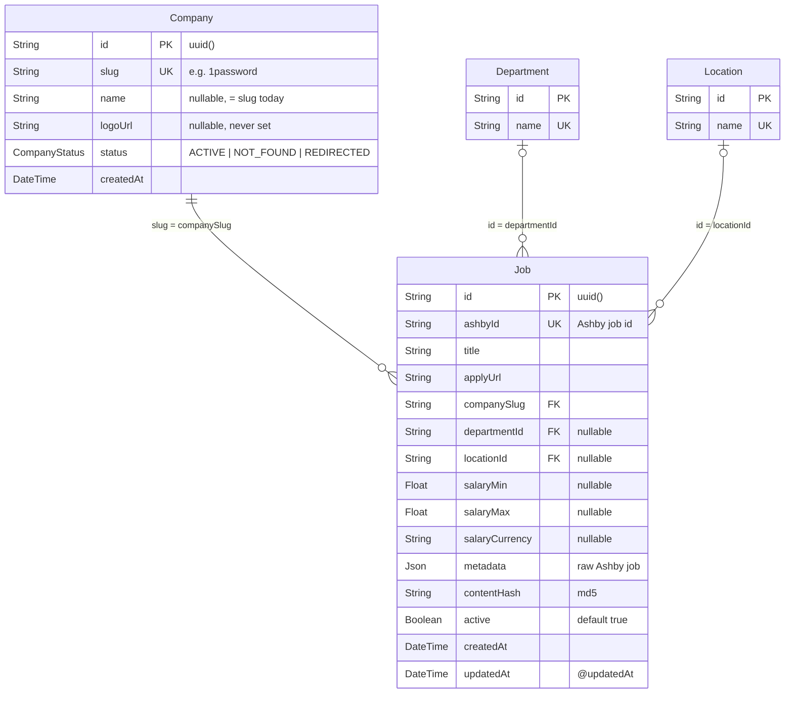

# 05 · Database & Cache

Schema file: [prisma/schema.prisma](file:///Users/pavanreddy/Documents/anti-gravity/job-scrapper/prisma/schema.prisma) ·
Provider: **PostgreSQL** (`DATABASE_URL`) · Client: `prisma-client-js` · Sync method: `npx prisma db push` (no migrations folder).

## 1. ER Diagram



## 2. Models

### `enum CompanyStatus`
| Value | Set by | Meaning |
|---|---|---|
| `ACTIVE` | default, `Seed.ts` | Scraped by both scrapers |
| `NOT_FOUND` | `Scraper.ts` on HTTP 404 | Excluded from future scrapes (no automatic recovery) |
| `REDIRECTED` | — (unused) | Reserved |

### `Company`
- `slug` is the **natural key** used everywhere (FK target for `Job.companySlug`, Ashby path param).
- `name` defaults to `slug` on seed; `name` and `logoUrl` can be enriched from Ashby's `window.__appData` via `npm run discover -- --enrich`.

### `Department` / `Location`
- Lookup tables keyed by unique `name` (sanitized string from Ashby, e.g. `"Remote"`, `"London, UK"`). Upserts use an in-memory `Map` cache, in-flight `Promise` deduplication, and `findUnique` fallback for cross-process `P2002` race safety during `npm run scrape:parallel`.

### `Job`
- `ashbyId` unique → upsert key.
- `metadata` = recursively sanitized raw Ashby job object (`sanitizeJsonMetadata()` strips `\u0000` null bytes and lone UTF-16 surrogates; `descriptionHtml` is cleaned of `<script>`/`<style>`/`<iframe>`/inline JS and oversized base64 data URIs). Written on **create** and refreshed on **update**.
- `contentHash` = `md5("${title}|${location}|${department}|${salary.min}|${salary.max}")`.
- `active` is set `true` on upsert, and automatically set `false` via `deactivateStaleJobs()` when a job disappears from a company's live board.
- Indexes: `companySlug`, `departmentId`, `locationId`, `active`.
- No `onDelete` cascade → deleting a `Company` requires deleting its jobs first (done in `DbClean.ts`).

## 3. API → DB Field Mapping (in `Scraper.ts` & `AshbyClient.ts`)

| Ashby field | DB column | Notes |
|---|---|---|
| `id` | `Job.ashbyId` | |
| `title` | `Job.title` | updated on change |
| `applyUrl` | `Job.applyUrl` | updated on change |
| `department` | `Department.name` → `Job.departmentId` | upsert + in-memory cache + in-flight deduplication |
| `location` | `Location.name` → `Job.locationId` | upsert + in-memory cache + in-flight deduplication |
| `compensation.summaryComponents` (`Salary`) | `salaryMin/Max/Currency` | extracted via `extractSalary()` in `AshbyClient.ts` |
| *(entire object)* | `Job.metadata` | updated on change |
| — | `Job.companySlug` | from the company being scraped |

## 4. Redis Cache

Client: [src/lib/Redis.ts](file:///Users/pavanreddy/Documents/anti-gravity/job-scrapper/src/lib/Redis.ts) (shared singleton).

| Setting | Value |
|---|---|
| URL | `REDIS_URL` or fallback `redis://localhost:6379` (supports `rediss://` e.g. Upstash) |
| `lazyConnect` | `true` — `Scraper.initRedis()` calls `connect()` explicitly |
| Retry | up to 3 retries (50/100/150 ms), then gives up → cache disabled for the run |
| Errors | `ECONNREFUSED` silenced; others logged |

**Key schema**

| Key | Value | TTL | Written | Read |
|---|---|---|---|---|
| `job:{ashbyId}:hash` | md5 content hash | 7 days (604,800 s) | after each 100-job DB batch, via pipeline | `filterChangedJobs()` (one `GET` per job, sequential) |

Only `Scraper.ts` uses Redis. If the key matches the new hash the job is skipped entirely (no DB write). Because TTL is 7
days, every job is re-upserted at least weekly.

> Current `.env` has **no `REDIS_URL`**, so it falls back to localhost; if no local Redis is running, the scraper prints
> `Redis: ⚠️ Disabled` and upserts every job every run.

## 5. Useful SQL (for `db:menu` option 7)

```sql
SELECT "companySlug", COUNT(*) FROM "Job" GROUP BY 1 ORDER BY 2 DESC LIMIT 20;
SELECT status, COUNT(*) FROM "Company" GROUP BY 1;
SELECT title, metadata->'compensation'->>'scrapeableCompensationSalarySummary' AS pay FROM "Job"
 WHERE metadata->'compensation' IS NOT NULL LIMIT 20;
SELECT l.name, COUNT(*) FROM "Job" j JOIN "Location" l ON l.id = j."locationId" GROUP BY 1 ORDER BY 2 DESC LIMIT 20;
```
