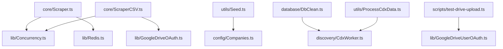

# 06 · Module Reference (file-by-file)

Base path: `/Users/pavanreddy/Documents/anti-gravity/job-scrapper`. Line numbers reflect the tree as of 2026-10-22.

## Dependency Graph (internal imports)

Every file that touches the DB creates its **own** `new PrismaClient()` at module scope.

---

## `src/core/`

### [Scraper.ts](file:///Users/pavanreddy/Documents/anti-gravity/job-scrapper/src/core/Scraper.ts) — DB scraper
| Symbol | Lines | Description |
|---|---|---|
| `CONCURRENCY_LIMIT = 15`, `BATCH_SIZE = 100` | [L16-17](file:///Users/pavanreddy/Documents/anti-gravity/job-scrapper/src/core/Scraper.ts#L16-L17) | Tunables |
| `interface AshbyJob` | [L20-35](file:///Users/pavanreddy/Documents/anti-gravity/job-scrapper/src/core/Scraper.ts#L20-L35) | Assumed API shape (⚠️ `compensationTier` is wrong) |
| `interface ProcessedJob` | [L41-53](file:///Users/pavanreddy/Documents/anti-gravity/job-scrapper/src/core/Scraper.ts#L41-L53) | Row ready for upsert |
| `class AshbyScraper` | [L58-309](file:///Users/pavanreddy/Documents/anti-gravity/job-scrapper/src/core/Scraper.ts#L58-L309) | Holds `departmentCache`, `locationCache` (Map name→id), `isRedisConnected` |
| `initRedis()` | [L66-77](file:///Users/pavanreddy/Documents/anti-gravity/job-scrapper/src/core/Scraper.ts#L66-L77) | Connects if status `wait`; sets flag |
| `fetchJobs(slug)` | [L82-97](file:///Users/pavanreddy/Documents/anti-gravity/job-scrapper/src/core/Scraper.ts#L82-L97) | Ashby GET with comp; 404 → `NOT_FOUND` |
| `generateHash(job)` | [L102-105](file:///Users/pavanreddy/Documents/anti-gravity/job-scrapper/src/core/Scraper.ts#L102-L105) | md5 of title/location/department/comp |
| `getOrCreateDepartment(name)` | [L110-126](file:///Users/pavanreddy/Documents/anti-gravity/job-scrapper/src/core/Scraper.ts#L110-L126) | Cached upsert |
| `getOrCreateLocation(name)` | [L131-147](file:///Users/pavanreddy/Documents/anti-gravity/job-scrapper/src/core/Scraper.ts#L131-L147) | Cached upsert |
| `filterChangedJobs(jobs)` | [L152-168](file:///Users/pavanreddy/Documents/anti-gravity/job-scrapper/src/core/Scraper.ts#L152-L168) | Redis hash compare |
| `batchUpsertJobs(jobs)` | [L173-222](file:///Users/pavanreddy/Documents/anti-gravity/job-scrapper/src/core/Scraper.ts#L173-L222) | `$transaction` of 100 upserts + Redis pipeline |
| `processCompanyJobs(slug, jobs)` | [L227-256](file:///Users/pavanreddy/Documents/anti-gravity/job-scrapper/src/core/Scraper.ts#L227-L256) | Filter + map to `ProcessedJob` |
| `runAll()` (public) | [L261-308](file:///Users/pavanreddy/Documents/anti-gravity/job-scrapper/src/core/Scraper.ts#L261-L308) | Orchestrator |
| `require.main` guard | [L311-323](file:///Users/pavanreddy/Documents/anti-gravity/job-scrapper/src/core/Scraper.ts#L311-L323) | Safe to import `AshbyScraper` |

### [ScraperCSV.ts](file:///Users/pavanreddy/Documents/anti-gravity/job-scrapper/src/core/ScraperCSV.ts) — CSV scraper
| Symbol | Lines | Description |
|---|---|---|
| `interface JobRecord` | [L19-26](file:///Users/pavanreddy/Documents/anti-gravity/job-scrapper/src/core/ScraperCSV.ts#L19-L26) | CSV row |
| `fetchJobsForCompany(slug)` | [L31-49](file:///Users/pavanreddy/Documents/anti-gravity/job-scrapper/src/core/ScraperCSV.ts#L31-L49) | Ashby GET (no comp) → `JobRecord[]` |
| `escapeCSV(value)` | [L54-59](file:///Users/pavanreddy/Documents/anti-gravity/job-scrapper/src/core/ScraperCSV.ts#L54-L59) | RFC-4180-ish quoting (no `\r` handling) |
| `formatCSVRow(job)` | [L64-73](file:///Users/pavanreddy/Documents/anti-gravity/job-scrapper/src/core/ScraperCSV.ts#L64-L73) | |
| `uploadToGoogleDrive(path)` | [L78-81](file:///Users/pavanreddy/Documents/anti-gravity/job-scrapper/src/core/ScraperCSV.ts#L78-L81) | Wraps service-account `uploadWithOAuth` |
| `scrapeToCSV()` | [L86-179](file:///Users/pavanreddy/Documents/anti-gravity/job-scrapper/src/core/ScraperCSV.ts#L86-L179) | Orchestrator |
| top-level call | [L182](file:///Users/pavanreddy/Documents/anti-gravity/job-scrapper/src/core/ScraperCSV.ts#L182) | ⚠️ Runs on import |

## `src/discovery/`

### [CdxWorker.ts](file:///Users/pavanreddy/Documents/anti-gravity/job-scrapper/src/discovery/CdxWorker.ts)
| Symbol | Lines | Description |
|---|---|---|
| `CDX_API_URL`, `VALID_SLUG_REGEX`, `BLOCKLIST` | [L12-24](file:///Users/pavanreddy/Documents/anti-gravity/job-scrapper/src/discovery/CdxWorker.ts#L12-L24) | Blocklist: login, api, feed, jobs, careers, admin, dashboard, search, assets, static, fonts, css, js, favicon, robots.txt, null, undefined, true, false, 0x, 100vh, 500ms, void |
| `export isValidSlug(slug)` | [L29-45](file:///Users/pavanreddy/Documents/anti-gravity/job-scrapper/src/discovery/CdxWorker.ts#L29-L45) | **Shared validator** (used by DbClean, ProcessCdxData) |
| `fetchAshbyUrls()` | [L50-69](file:///Users/pavanreddy/Documents/anti-gravity/job-scrapper/src/discovery/CdxWorker.ts#L50-L69) | CDX call (limit 1000) |
| `extractCompanySlug(url)` | [L74-96](file:///Users/pavanreddy/Documents/anti-gravity/job-scrapper/src/discovery/CdxWorker.ts#L74-L96) | |
| `export runDiscovery()` | [L101-132](file:///Users/pavanreddy/Documents/anti-gravity/job-scrapper/src/discovery/CdxWorker.ts#L101-L132) | Sequential upserts |
| `require.main` guard | [L135-145](file:///Users/pavanreddy/Documents/anti-gravity/job-scrapper/src/discovery/CdxWorker.ts#L135-L145) | Safe to import |

## `src/lib/`

### [Concurrency.ts](file:///Users/pavanreddy/Documents/anti-gravity/job-scrapper/src/lib/Concurrency.ts)
- `createLimiter(n)` [L13-43](file:///Users/pavanreddy/Documents/anti-gravity/job-scrapper/src/lib/Concurrency.ts#L13-L43) — p-limit clone (CommonJS-friendly). Returns `limit(fn)`; errors propagate (so one rejected task rejects the `Promise.all`).
- `chunk(arr, size)` [L48-54](file:///Users/pavanreddy/Documents/anti-gravity/job-scrapper/src/lib/Concurrency.ts#L48-L54) — unused.

### [Redis.ts](file:///Users/pavanreddy/Documents/anti-gravity/job-scrapper/src/lib/Redis.ts)
- Calls `dotenv.config()`; exports `redis` (ioredis, `lazyConnect`, 3-retry strategy) [L52-71](file:///Users/pavanreddy/Documents/anti-gravity/job-scrapper/src/lib/Redis.ts#L52-L71); error handler [L80-88](file:///Users/pavanreddy/Documents/anti-gravity/job-scrapper/src/lib/Redis.ts#L80-L88).

### [GoogleDriveOAuth.ts](file:///Users/pavanreddy/Documents/anti-gravity/job-scrapper/src/lib/GoogleDriveOAuth.ts) (service account)
- `authorize()` [L18-44](file:///Users/pavanreddy/Documents/anti-gravity/job-scrapper/src/lib/GoogleDriveOAuth.ts#L18-L44) — reads `apikeys/google-credentials.json`, JWT.
- `export uploadWithOAuth(filePath, folderId?)` [L49-102](file:///Users/pavanreddy/Documents/anti-gravity/job-scrapper/src/lib/GoogleDriveOAuth.ts#L49-L102) — always `text/csv`.
- `export listFiles()` [L107-132](file:///Users/pavanreddy/Documents/anti-gravity/job-scrapper/src/lib/GoogleDriveOAuth.ts#L107-L132).

### [GoogleDriveUserOAuth.ts](file:///Users/pavanreddy/Documents/anti-gravity/job-scrapper/src/lib/GoogleDriveUserOAuth.ts) (user OAuth2)
- `getAuthenticatedClient()` [L28-74](file:///Users/pavanreddy/Documents/anti-gravity/job-scrapper/src/lib/GoogleDriveUserOAuth.ts#L28-L74) — loads creds/token, refreshes.
- `getNewToken(client)` [L79-105](file:///Users/pavanreddy/Documents/anti-gravity/job-scrapper/src/lib/GoogleDriveUserOAuth.ts#L79-L105) — terminal consent flow (interactive; unsuitable for unattended cron on first run).
- `askQuestion(q)` [L110-122](file:///Users/pavanreddy/Documents/anti-gravity/job-scrapper/src/lib/GoogleDriveUserOAuth.ts#L110-L122).
- `export uploadWithUserOAuth(filePath, folderId?)` [L128-178](file:///Users/pavanreddy/Documents/anti-gravity/job-scrapper/src/lib/GoogleDriveUserOAuth.ts#L128-L178).
- `export listUserFiles()` [L183-209](file:///Users/pavanreddy/Documents/anti-gravity/job-scrapper/src/lib/GoogleDriveUserOAuth.ts#L183-L209).

## `src/database/`

### [DbMenu.ts](file:///Users/pavanreddy/Documents/anti-gravity/job-scrapper/src/database/DbMenu.ts)
`showDashboard` · `showJobsPerCompany` · `showTopSalaries` · `searchJobs` · `showLocations` · `showGhostCompanies` · `runSqlQuery` · `prompt` (menu loop). Runs on import.

### [DbInspect.ts](file:///Users/pavanreddy/Documents/anti-gravity/job-scrapper/src/database/DbInspect.ts)
`inspectDatabase()` — `information_schema` tables/columns + `COUNT(*)` (skips `_`-prefixed tables). Runs on import.

### [DbClean.ts](file:///Users/pavanreddy/Documents/anti-gravity/job-scrapper/src/database/DbClean.ts)
`cleanDatabase()` — `--execute` gate; jobs then companies. Runs on import.

## `src/utils/`

- [Seed.ts](file:///Users/pavanreddy/Documents/anti-gravity/job-scrapper/src/utils/Seed.ts) — `seed()`; memory diff + `createMany`. Runs on import.
- [ProcessCdxData.ts](file:///Users/pavanreddy/Documents/anti-gravity/job-scrapper/src/utils/ProcessCdxData.ts) — `export processRawCDXData(rows)`; has `require.main` guard.
- [Verify.ts](file:///Users/pavanreddy/Documents/anti-gravity/job-scrapper/src/utils/Verify.ts) — `check()`; counts. Runs on import.

## `src/config/`

- [Companies.ts](file:///Users/pavanreddy/Documents/anti-gravity/job-scrapper/src/config/Companies.ts) — `export TARGET_COMPANIES: string[]` (`deel`, `remote`, `reddit`, `multiverse`). Note: at time of analysis `remote` returns 404 and `deel`/`reddit` return 0 jobs from Ashby.

## `scripts/`

- [GenerateDocs.ts](file:///Users/pavanreddy/Documents/anti-gravity/job-scrapper/scripts/GenerateDocs.ts) — `getFileIcon`, `discoverFiles`, `parseJSDoc`, `parsePrismaSchema`, `generateHTML`, `generateTreeHTML`, `main` → `docs/project-explorer.html`.
- [generate-readme.ts](file:///Users/pavanreddy/Documents/anti-gravity/job-scrapper/scripts/generate-readme.ts) — `parseCSV`, `generateMarkdownTable`, `main` → `JOBS.md`.
- [test-drive-upload.ts](file:///Users/pavanreddy/Documents/anti-gravity/job-scrapper/scripts/test-drive-upload.ts) — writes temp file, `uploadWithUserOAuth`, `listUserFiles`, deletes temp file.

## Coding Conventions

- PascalCase file names for modules (`Scraper.ts`, `DbMenu.ts`); kebab-case for some scripts (`generate-readme.ts`).
- Every file starts with a JSDoc block: `@file`, `@summary`, `@tags` (consumed by `GenerateDocs.ts`).
- Every function/method/class gets a JSDoc `@summary` (ESLint `jsdoc/require-jsdoc` warns otherwise).
- Emoji-rich console logging; no logging library.
- `any` is allowed (`@typescript-eslint/no-explicit-any: off`); unused vars prefixed `_` are ignored.
