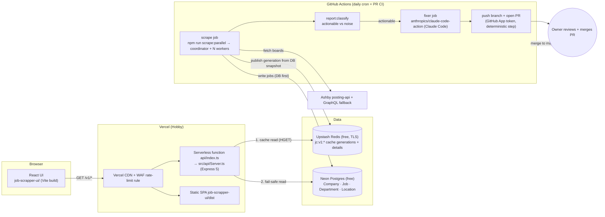
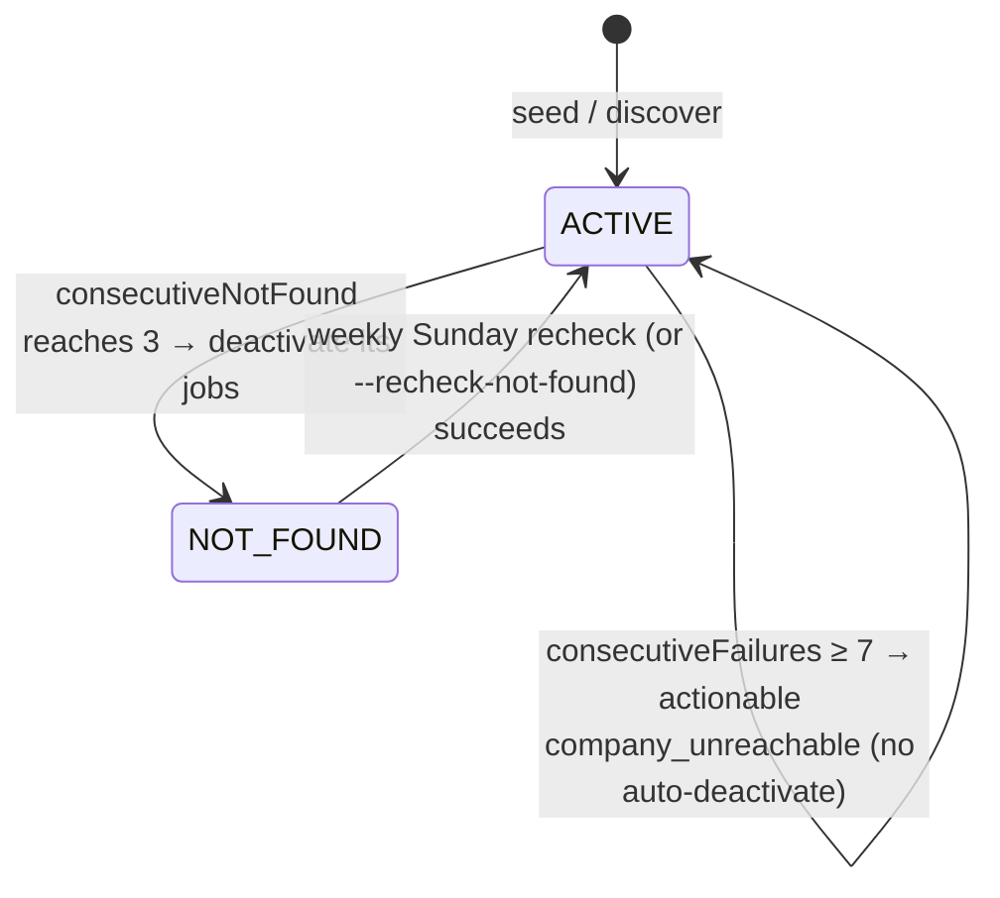

# 15 · System Architecture & Flows

> Canonical reference for component diagrams, sequence flows, and state machines across the Ashby Job Scraper ecosystem.

---

## 1. System Component Architecture



---

## 2. Write-Path Sequence (Scheduled Scrape Run)

```mermaid
sequenceDiagram
  autonumber
  participant Cron as GH Actions cron (06:17 UTC)
  participant Co as ClusterScraper (coordinator)
  participant W as Workers ×4 (--ipc-worker)
  participant A as Ashby
  participant PG as Neon Postgres
  participant P as Publisher (src/cache/Publisher.ts)
  participant R as Upstash Redis
  participant ET as ErrorTracker v2
  Cron->>Co: npm run scrape:parallel -- --workers=4
  Co->>PG: load ACTIVE companies (+ NOT_FOUND on Sundays)
  Co->>W: fork + shard (round-robin)
  loop each company (isolated try/catch)
    W->>A: GET posting-api (retry/backoff) → GraphQL fallback on 404/403/400
    W->>PG: createMany new / upsert changed+inactive / deactivate missing (contentHash compare, no Redis)
    W->>PG: update Company counters (consecutiveNotFound/Failures, lastSuccessAt)
  end
  W-->>Co: IPC report (counters, events)
  Co->>Co: Promise.allSettled + watchdog → merge reports
  alt all workers ok
    Co->>P: publishCacheGeneration({runId, scrapeFinishedAt, prisma, redis})
    P->>R: SET jc:v1:lock:publish NX
    P->>PG: snapshot active+listed jobs (LIST_SELECT, no metadata) + facets + companies
    P->>P: sanity gate vs meta:lastPublish (gated → SET meta:lastScrapeAt only, stop, exit 2)
    P->>R: HSET jc:v1:details:<crc32(id)%8> new/changed details + jc:v1:details:index
    P->>R: HSET jc:v1:gen:<gen> pages/facets/companies/meta … then __manifest LAST; verify HLEN
    P->>R: MULTI: SET current, PERSIST new gen, SET meta:lastScrapeAt + meta:lastPublish, EXPIRE old gen 900 → EXEC
    P->>R: HDEL removed ids from details shards + index
  else a worker failed
    Note over Co,R: no publish, lastScrapeAt not updated (old generation stays live)
  end
  Co->>ET: save output/reports/<YYYY-MM>/<runId>.json (+ latest-*.json)
  Note over Co,ET: then `npm run report:classify` adds issues/diff to the JSON and writes <runId>.md
  Co-->>Cron: exit 0 (ok) | 1 (hard failure) | 2 (scrape ok, publish failed or gated)
```

---

## 3. Read-Path Sequence (API Request Flow)

```mermaid
sequenceDiagram
  autonumber
  participant B as Browser (UI)
  participant C as Vercel CDN
  participant F as API function
  participant L as In-process LRU (30 s)
  participant R as Upstash Redis
  participant PG as Neon Postgres
  B->>C: GET /v1/jobs?page=2&workplaceType=Remote
  alt CDN fresh (s-maxage 300)
    C-->>B: 200 (cached at edge)
  else
    C->>F: forward
    F->>F: canonicalJobsKey(query) → "jobs?page=2&workplaceType=Remote"; isCacheableView? (no → MISS → Postgres, no Redis)
    F->>R: MGET jc:v1:current jc:v1:meta:lastScrapeAt (only if not cached in-process; 300 s)
    F->>R: HGET jc:v1:gen:<gen> __manifest (only once per gen per instance)
    F->>L: lookup "<gen>|<key>"
    alt LRU hit
      L-->>F: body
    else
      F->>R: HGET jc:v1:gen:<gen> "jobs?page=2&workplaceType=Remote"
      alt HIT
        R-->>F: gzip body
        F-->>C: 200 X-Cache: HIT (or STALE if snapshot old)
      else MISS (view/page not cached, field missing)
        F->>PG: same query via src/api/db/queries.ts
        F-->>C: 200 X-Cache: MISS + reason
      else Redis down / timeout / breaker open / budget exceeded
        F->>PG: query
        F-->>C: 200 X-Cache: BYPASS + reason
      end
    end
  end
  Note over F,PG: Postgres down → 503 {code: UPSTREAM_UNAVAILABLE, retryAfterSeconds: 5}
```

---

## 4. Job Lifecycle State Machine

```mermaid
stateDiagram-v2
  [*] --> Active: first seen (createMany)
  Active --> Active: unchanged (contentHash equal → no write)
  Active --> Active: changed (upsert; nullable columns cleared with null)
  Active --> Inactive: missing from a successful board fetch
  Active --> Inactive: company quarantined (3 consecutive confirmed 404s)
  Active --> PendingEmpty: board returns 0 jobs but company had ≥5 active (P1-T13)
  PendingEmpty --> Inactive: still empty next run
  PendingEmpty --> Active: jobs back
  Inactive --> Active: job reappears (contentHash compare sees active=false → upsert active=true)
```



---

## 5. Company Lifecycle State Machine



---

## 6. Self-Healing Fix Loop (Planned: P4-T03)
*See `documentation/plan/02-target-architecture.md` §7 and `documentation/plan/07-error-report-and-self-healing-loop.md`.*

## 7. Agent Routing Table (Planned: P4-T04)
*See `documentation/agents/roster.md`.*

## 8. Cross-Component Invariants (Planned: P4-T05)
*See `documentation/plan/02-target-architecture.md` §8.*

## 9. Failure-Mode Matrix (Planned: P4-T05)
*See `documentation/plan/02-target-architecture.md` §9.*

## 10. Architectural Glossary (Planned: P4-T05)
*See `documentation/plan/02-target-architecture.md` §10.*
