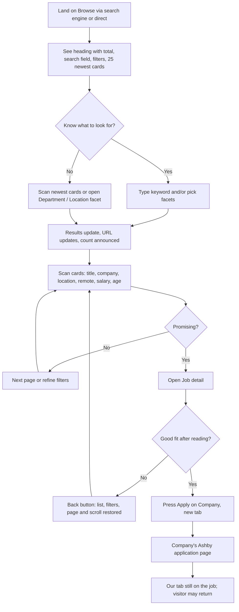
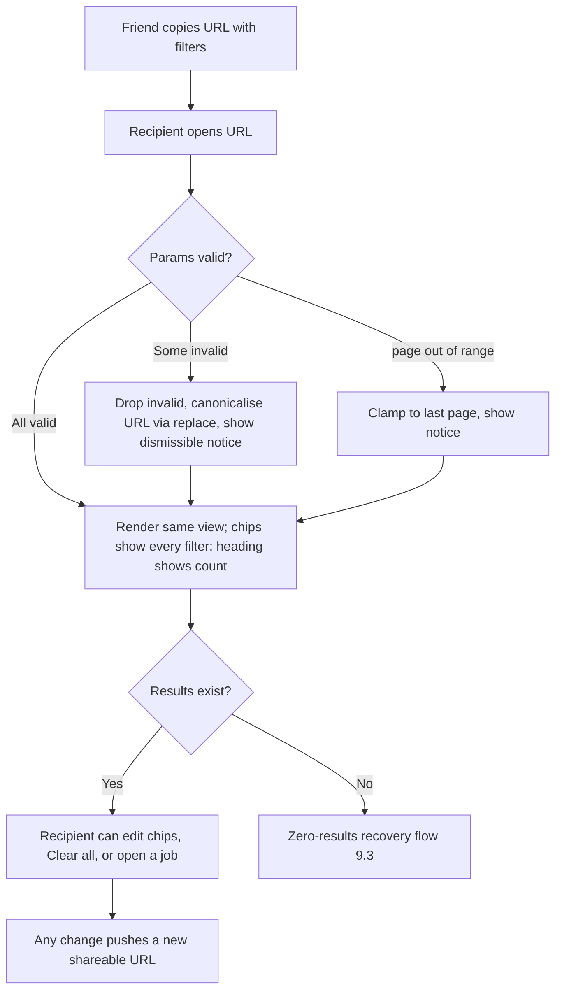
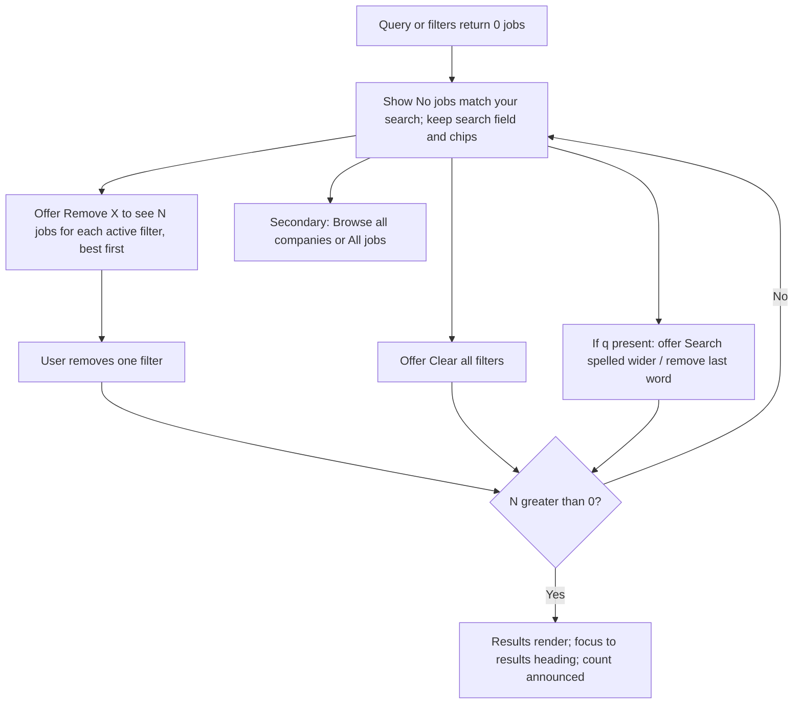
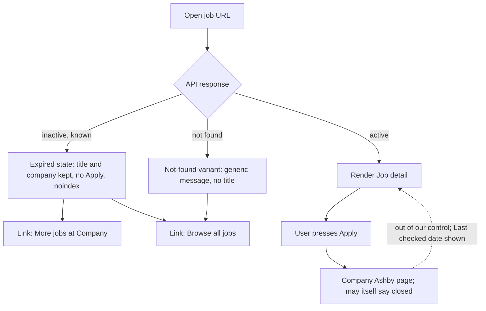
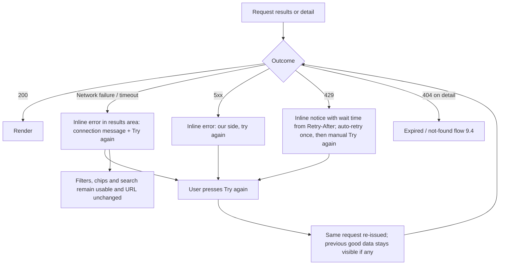

# 04 · Information Architecture & Flows

> **Status:** DESIGN ONLY. Depends on [00](./00-brief-and-index.md) and [03](./03-personas-and-use-cases.md). UC-nn
> references point at 03. API needs are collected in section 12 as "requirements for 08".
> _Authored 2026-10-22._

## 1. Sitemap

```
/                              Browse (search + facets + sort + paginated job cards)         indexable (clean URL only)
├─ /jobs/{id}/{slug}           Job detail (light Read mode)                                   indexable
├─ /companies                   Company directory (A-Z, searchable, paginated)                 indexable (page 1)
│  └─ /companies/{slug}         Company page (company header + Browse-style list)              indexable (clean URL only)
├─ /about                      About / How it works                                           indexable
├─ /privacy                    Privacy and data note                                          indexable
├─ /sitemap.xml                 (jobs + companies + static; see 04 §3.7)                       machine
├─ /robots.txt                                                                                 machine
└─ any other path               404                                                            noindex
   (runtime failure)            Error state (inline region, or full page for unrecoverable)    noindex
```

Decision: `/companies` (directory) is a lightweight list page, not in the brief's screen list but needed so the company
link on Job detail does not strand users and so the company pages are crawlable. It reuses the same pagination component
and a single text field. If the owner prefers fewer screens, drop it and link companies only from cards (open question
Q4).

There is deliberately **no** separate "Search results" page. Search is Browse with `q`.

## 2. Navigation model

### 2.1 Global header (one row, same on all pages)

| Breakpoint | Content |
|---|---|
| Mobile (under 640) | Site name (links to `/`), Browse-wide search field is **not** in the header; it lives at the top of Browse. Header right: "Companies", "About" in a compact overflow-free row (two text links; no hamburger needed with so few items), theme toggle as an icon button with accessible name "Theme: system. Change theme". |
| Tablet / desktop | Site name left; "Browse", "Companies", "About" text links; theme toggle right. Current page marked with `aria-current="page"` and an underline (not colour alone). |

Rationale: only three destinations, so no hamburger. A hamburger would add a tap and hide the About page that builds
trust for link-followers (P3).

### 2.2 Footer
Links: About, Privacy, "Data comes from companies' public Ashby job boards", "Last updated {date}", source-code link
(if the owner chooses; Q6). No newsletter, no social.

### 2.3 In-page navigation
- **Breadcrumb** on Job detail and Company page: `Jobs > {Company} > {Job title}`. On mobile it collapses to a single
  "Back to results" style link (see 2.4).
- **Skip links:** "Skip to results" (first focusable) and "Skip to filters" on Browse.
- **Back to results** (Job detail): see 2.4.

### 2.4 Back behaviour
- The browser back button is the primary mechanism; the app never intercepts it.
- Job detail shows a link "Back to results" **only when the visitor arrived from our Browse or Company page in this tab**
  (tracked in router memory, not storage). It calls `history.back()`. If they arrived any other way (shared link,
  search engine), the link reads "All jobs at {Company}" and goes to the Company page; a second text link "Browse
  all jobs" goes to `/`.
- Rationale: never fabricate a results page the visitor never saw; always keep state in the URL so Back restores it.

## 3. URL scheme

Principles: (1) the URL is the single source of truth for everything the visitor chose; (2) human-readable names, short
keys; (3) canonical form so one view equals one URL; (4) no tracking params ever; (5) the app must tolerate any garbage
in the query string.

### 3.1 Routes

| Route | Example | Notes |
|---|---|---|
| Browse | `/` | all params of 3.2 |
| Job detail | `/jobs/9f3c2e1a-4b7d-4d52-8d1e-5a6b7c8d9e0f/senior-frontend-engineer` | `{id}` = Ashby job id (`Job.ashbyId`, stable external id); `{slug}` = title slug (cosmetic, lowercased, ASCII, max 80 chars) |
| Company directory | `/companies?q=de&page=2` | params: `q`, `page`, `size` only (same validation as 3.2) |
| Company page | `/companies/deel` | `{slug}` = `Company.slug`. Accepts the Browse params except `company`. |
| Static | `/about`, `/privacy` | |

Job detail slug rule: if `{slug}` is wrong or missing, the page still resolves by `{id}` and replaces the URL with the
canonical slug (HTTP 301/308 if edge-rendered, `history.replaceState` otherwise). The `{id}` alone (`/jobs/{id}`) also
resolves.

### 3.2 Query parameters (Browse and Company page)

| Param | Type | Multi? | Default (omitted from URL) | Validation and normalisation |
|---|---|---|---|---|
| `q` | string | no | empty | Trim, collapse inner whitespace, max 100 chars (truncate), drop control chars. Under 2 chars after trim means ignored. Case preserved as typed, matched case-insensitively. |
| `company` | company slug | yes (repeat key) | none | Must match `^[a-z0-9]+(?:-[a-z0-9]+)*$`, max 50 chars (same rule as `isValidSlug`). Unknown slugs kept (shown as a chip with prettified slug, yield zero results with recovery). Max 10 values. Not accepted on Company page. |
| `department` | exact department name | yes (repeat key) | none | Exact, case-sensitive match to a `Department.name`; unmatched values yield zero results, not silently dropped. Max 10 values, each max 100 chars. |
| `location` | exact location string | yes (repeat key) | none | Exact match to `Location.name` (free text, may contain commas, hence repeated keys, never comma-joined). Max 10 values, each max 120 chars. |
| `remote` | `1` | no | absent | Only the literal `1` is valid. `0`, `true`, anything else is ignored (remote-only is a toggle, there is no "on-site only" in v1). |
| `salary` | `1` | no | absent | `1` means "salary listed". Anything else ignored. |
| `type` | enum | yes (repeat key) | none | One of `FullTime`, `PartTime`, `Contract`, `Intern`, `Temporary` (values as Ashby publishes in `metadata.employmentType`; list reconciled with 08, requirement R04-4). Unknown values ignored with a notice. |
| `posted` | enum | no | absent (any time) | `24h`, `7d`, `30d`. Anything else ignored with a notice. |
| `sort` | enum | no | `newest`, or `relevance` when `q` is present | `relevance` (only valid with `q`), `newest`, `salary`, `company`. `relevance` without `q` falls back to `newest`. Default value is stripped from the canonical URL. |
| `page` | int | no | `1` | Integer 1..totalPages. Non-numeric, 0, negative, decimal become 1. Above totalPages is clamped to the last page with a notice. `page=1` is stripped. |
| `size` | int | no | `25` | One of `25`, `50`, `100`. Other values become 25. `size=25` is stripped. |

Repeat-key encoding: `?department=Engineering&department=Sales`. Values are percent-encoded with `+` for spaces
accepted on input and `%20` produced on output (single convention in the serialiser).

Full example:
`/?q=data+engineer&department=Engineering&location=Remote&location=London%2C+UK&remote=1&salary=1&type=FullTime&posted=7d&sort=salary&page=3&size=50`

Company page example: `/companies/deel?department=Engineering&page=2`.

Directory params: `q` (name contains), `page`, `size`. No A-Z jump bar in v1.

### 3.3 Canonical form (serialiser rules)

1. Drop all unknown params and all defaults.
2. Order params alphabetically by key; within a multi key, sort values alphabetically (so the same filter set yields a
   byte-identical URL regardless of click order).
3. Lowercase keys; enum values in their defined casing; `q` trimmed.
4. If the incoming URL differs from its canonical form, the app **replaces** the history entry (no extra entry) with the
   canonical URL. Visitors and crawlers therefore never get two URLs for one view.
5. `rel=canonical` always points at the canonical form of the current URL (self-referencing).

### 3.4 State lives in the URL (and nowhere else)

| State | Where | Notes |
|---|---|---|
| search, facets, sort, page, size | query string | Router reads the URL, API request derives from it; UI controls are views of the URL. |
| Open/closed state of facet groups, "Show more" expansion, mobile filter panel | component state, **not** the URL | Not part of the shareable view. The mobile filter panel is always closed after Back or reload. |
| Draft text in facet search boxes | component state | |
| Scroll position | browser history scroll restoration + data cache | see 5.5 |
| Theme | `localStorage` (try/catch; falls back to system) | the only persisted preference. |

### 3.5 Behaviour on change

| Action | Page resets to 1? | History entry |
|---|---|---|
| Add/remove a facet value, toggle Remote/Salary, change Sort, change Page size, clear chip, Clear all | yes | **push** (one entry per discrete action) |
| Typing in search | yes | first debounced update after the field was focused: **push**; further updates while the same field focus continues: **replace**; Enter or choosing a suggestion: **push** if the value differs from the current URL |
| Change page (Previous/Next/number/jump) | n/a | push |
| Canonicalisation, clamping `page`, dropping invalid params | n/a | **replace** |
| Facet-internal "search within facet" typing | n/a | none (local state) |

Back/forward: because every discrete action is a push of a full URL, Back steps exactly one user action. The app
listens to `popstate`/router navigation and re-derives all UI from the URL, including the search field text and chips.

Deep link: opening any valid URL cold renders the matching view (server/edge-rendered first paint if the stack allows,
otherwise a skeleton in the same layout). Chips and heading make the filtered state obvious.

Invalid params (UC-19): unknown keys silently dropped; invalid values for enum params dropped with a dismissible
notice "Some filters in this link were not recognised and were ignored" (role=status, shown once, link-free,
dismiss button); out-of-range page clamped with notice "Page 9999 does not exist. Showing page 48, the last page."

### 3.6 Indexable vs noindex

Goal: let search engines find job and company pages; keep millions of filter permutations out of the index.

| URL pattern | Robots meta | Canonical | In sitemap |
|---|---|---|---|
| `/` (no params) | `index, follow` | `/` | yes |
| `/` with **any** of `q`, filters, `sort`, `size`, or `page` greater than 1 | `noindex, follow` | self (canonical form) | no |
| `/companies` (no params), `/companies?page=N` | page 1 `index, follow`; `page` above 1 `noindex, follow` | self | page 1 only |
| `/companies/{slug}` (no params) | `index, follow` | self | yes |
| `/companies/{slug}` with any param | `noindex, follow` | self | no |
| `/jobs/{id}/{slug}` active | `index, follow` | canonical slugged URL | yes |
| `/jobs/{id}/{slug}` inactive/expired | `noindex` and 404/410 semantic status | none | removed |
| `/about`, `/privacy` | `index, follow` | self | yes |
| 404, error | `noindex` | none | no |

Rationale for noindex on pagination pages 2+: they are not stable (the list changes daily, job N moves), they add no
unique content, and the job pages themselves are discoverable through the sitemap and company pages. `follow` keeps
link equity flowing to jobs. We do not rely on `rel=prev/next` (ignored by major engines) but the pagination component
renders real `<a href>` links so crawlers and no-JS users can walk the list.

Open question Q3: whether to promote a few curated filtered landings (for example `/?remote=1`) to indexable
"collection" pages later. v1: no.

### 3.7 Sitemap and structured data (needs for 08)
- `sitemap.xml` index with children chunked at 10,000 URLs (about 34 k jobs implies 4 chunks), `lastmod` = job
  `updatedAt`. Generated at build or by the edge function from an API feed (R04-8).
- Job detail embeds `JobPosting` JSON-LD only when `postedAt` exists and `applyUrl` is valid; salary included as
  `baseSalary` only when min/max/currency exist and period is known; never invent `validThrough`.

## 4. Search behaviour

| Aspect | Decision |
|---|---|
| Placement | Search field is the first control on Browse and Company page, full width above facets and results (Operate: the task starts here). Label "Search jobs" (visible label on desktop; on mobile a visible label too, via placeholder-free design). Placeholder is only an example: "Title, company, or keyword", never the only label. |
| Scope (v1) | Title, company name and slug, department, location. Description text is **not** searched in v1 (not reliably present; costs an index). |
| Trigger | Debounce 300 ms after last keystroke; Enter submits immediately; clear button ("Clear search") shown when non-empty. |
| Minimum length | 2 characters. One character does nothing and shows no error. Pasting a long string is truncated at 100 chars with no message. |
| Matching | Case-insensitive, prefix-friendly on the last token ("engin" matches "engineer"), all tokens must match (AND). Exact phrase with quotes is out of scope for v1. |
| In-flight | New keystrokes cancel the previous request (stale responses are discarded). Skeletons appear only if results take longer than 100 ms; existing results stay visible and dim to 60 % opacity meanwhile (no layout jump). |
| History | See 3.5: one history entry per search "session". |
| Highlight | Matched tokens in job title and company name wrapped in `<mark>`. Highlight uses a background plus underline-free treatment with at least 3:1 contrast against text; `<mark>` content is announced normally by screen readers. Highlighting is a client-side substring pass over the displayed strings; it is a hint, not a promise of the backend's match logic. Not applied to location or department. |
| Suggestions | A combobox (ARIA 1.2 pattern: `role=combobox`, `aria-expanded`, `aria-controls`, `aria-activedescendant`, listbox with groups) opens at 2+ chars with up to 3 Companies, 3 Departments, 3 Locations. Groups have headings ("Companies", "Departments", "Locations"). Choosing a suggestion **applies that value as a facet** (and clears the typed text), it does not copy it into `q`. A final row "Search for 'x'" runs the keyword. Esc closes the list, then clears text on second Esc. Suggestions never open on page load or focus alone. |
| Suggestions failing | If the suggest endpoint fails or is slow (over 500 ms), the list simply does not appear; search still works. No error shown. |
| Empty query + Enter | No-op (keeps focus). |
| Recent searches | None in v1. |
| Privacy | Queries are sent to our API as part of the GET (needed to search); not stored by us (see 03 §6). |

## 5. Pagination model (decision)

### 5.1 Options considered (34,035 jobs, 25 per page = 1,362 pages)

| Criterion | Numbered pages + page size | Cursor Previous/Next | Load more / infinite scroll |
|---|---|---|---|
| Shareable position in URL | yes (`page=48`) | cursor token is opaque, ugly, expires | no (or fragile) |
| Back button / restore | yes, trivial | workable but token-dependent | notoriously broken; needs scroll restoration and re-fetch of every loaded chunk |
| Jump to a place ("page 40") | yes | no | no |
| SEO / no-JS | real links | real links but opaque | needs JS |
| Footer and landmarks reachable | yes | yes | no, footer is pushed away forever |
| Screen readers / keyboard | simple, predictable | simple | focus management hard; DOM grows to thousands of cards, hurting INP |
| Backend cost | offset deep pages cost more | cheapest, stable | cheapest per chunk |
| Mobile friendliness | fine with compact control | fine | most natural for thumbs |
| Duplicates/skips when data changes | possible between loads | none | possible |

### 5.2 Decision
**Numbered pages with a page-size choice** (25 default, options 25 / 50 / 100), compact on mobile (Previous, "Page N of
M" with a jump field, Next). No infinite scroll, no "load more".

Why: the brief requires pagination and shareable URLs, the user task is scan-and-judge in bounded chunks, state must
survive Back, and accessibility is simplest with discrete pages. Mobile uses the compact control rather than a different
paradigm so behaviour is identical everywhere. The cost (deep-offset queries) is a backend concern: 08 should either
cap depth or use keyset pagination internally while still accepting `page` (R04-1). Because users rarely go beyond a
few pages when search and facets exist, a depth cap is acceptable and designed for (5.4).

### 5.3 Component behaviour (exact)

**Summary line** (above the list, also repeated under the list): `Showing 1-25 of 34,035 jobs`
- Numbers use locale thousands separators. The range is rendered with a true en dash in the UI; written here as "1-25"
  for plain-text docs. Screen readers hear it as "1 to 25" via a visually hidden "to" if the engine reads the dash poorly.
- Last page partial: `Showing 34,026-34,035 of 34,035 jobs`.
- Single page: `Showing all 7 jobs`. One job: `Showing 1 job`. Zero: no pagination at all, zero-results state instead.
- Approximate total (`totalIsApproximate`): `Showing 1-25 of about 34,000 jobs`.

**Control** (below the list; also a minimal top variant: summary + page-size select + Previous/Next only):

```
Desktop/tablet:   < Previous   1  …  11  12  [13]  14  15  …  1,362   Next >     Go to page [____] Go     Jobs per page [25 v]
Mobile:           < Previous        Page [ 13 ] of 1,362        Next >
```

- Markup: `<nav aria-label="Pagination">` containing a list of links; the current page is an `<a aria-current="page">` that
  is visually distinct (filled, not colour alone) and still a link (to itself) so the list stays regular.
- Link names: "Page 13", current: "Page 13, current page", Previous: "Previous page", Next: "Next page"; at the ends
  Previous/Next on first/last page render as disabled text with `aria-disabled="true"` and are removed from the tab
  order.
- **Window and ellipsis rules** (7 slots total, symmetric, fixed width so the control does not jiggle):
  - Total pages at most 7: show all.
  - Current at most 4: `1 2 3 4 5 … last`.
  - Current at least last-3: `1 … last-4 last-3 last-2 last-1 last`.
  - Otherwise: `1 … c-1 c c+1 … last`.
  - Ellipsis is a non-interactive `<li aria-hidden="true">…</li>`; the information is carried by the "Go to page"
    field. Never two adjacent ellipses; never an ellipsis that hides exactly one page (replace with the page number).
- **Mobile (under 640):** only Previous, the current-page numeric input, "of 1,362", Next. Input is
  `inputmode="numeric"` `pattern="[0-9]*"`, labelled "Page number"; changing it and pressing Enter (or blurring with a
  changed valid value) navigates. Values out of range clamp with an inline hint "Enter a number from 1 to 1,362".
- **Go to page** (tablet/desktop): `<label>Go to page</label> <input type="number" min=1 max=N> <button>Go</button>`.
  Submits on Enter; invalid shows the inline hint above and does not navigate.
- **Page size**: `<select>` "Jobs per page" with 25 / 50 / 100; changing resets to page 1 (push) and announces
  "Showing 1-50 of 34,035 jobs".
- **Targets:** 44 px high on touch, minimum 24 px square with spacing everywhere.
- **Loading:** clicking a page keeps the old list visible at reduced opacity for up to 100 ms, then swaps to skeleton
  cards of the same count; pagination itself stays interactive but ignores clicks while a navigation is in flight to
  the same target.
- **Deep results cap:** if the API reports `maxResultWindow` (for example 10,000), pages beyond it are not offered; the
  summary reads `Showing 1-25 of 34,035 jobs` but the last link is page 400 and a note below the control says "You can
  browse the first 10,000 results. Narrow your search to see the rest." (requirement R04-1).

### 5.4 Focus management, announcements and scroll

After a page change (not after initial load):
1. The results container is replaced; focus moves to the **results heading** (`<h2 tabindex="-1">` "Results, page 13 of
   1,362"), so keyboard and screen-reader users start at the top of the new page, not stranded on a removed link.
2. The viewport scrolls so the top of the filters/results region is in view (`scrollIntoView({block: 'start'})` under a
   sticky-header offset; respects reduced motion by using instant scroll).
3. The live region (single `role="status"` `aria-live="polite"` element in the page, visually hidden) says: `Page 13 of
   1,362. Showing 301-325 of 34,035 jobs.` It is written **once**, after data renders, not on every intermediate state.
4. Page links remain real anchors: Ctrl/Cmd/middle-click opens them in a new tab normally.

### 5.5 Scroll restoration and Back
- History entries store scroll offset (the framework's scroll restoration) and the app keeps the last N=20 result sets in
  an in-memory cache keyed by canonical URL (stale-while-revalidate), so Back paints instantly and restores the scroll
  position; a revalidation then swaps in fresh data only if the ids differ, without moving the viewport (CLS safe).
- When returning from Job detail, the card the user opened gets focus (focus-visible ring) via a remembered job id in
  router state, so keyboard and screen-reader users keep their place (UC-11).
- After a normal navigation to a new URL (not Back), scroll goes to the top of the results region.
- If cache is cold and the API is slow, a skeleton fills the same height; scroll is restored once content height
  allows.

## 6. Facet design

| Facet | Control | Select model | Counts | Long list handling | URL param |
|---|---|---|---|---|---|
| Company | checkbox list | multi (OR) | yes | top 8 by count + "Show more" (expands to 30) + "Search companies" input + A-Z results only beyond 30 via search | `company` |
| Department | checkbox list | multi (OR) | yes | top 8 + Show more + search | `department` |
| Location | checkbox list | multi (OR) | yes | top 8 + Show more + search ("Search locations"); because locations are free text with many near-duplicates, list sorted by count desc | `location` |
| Remote | single switch "Remote only" | boolean | count of remote jobs shown in the label ("Remote only (6,812)") | n/a | `remote` |
| Salary | single switch "Salary listed" | boolean | yes | n/a | `salary` |
| Employment type | checkbox list | multi (OR) | yes | all (5 values) | `type` |
| Posted | radio group: Any time, Last 24 hours, Last 7 days, Last 30 days | single | optional, yes | n/a | `posted` |

Rules:
- **Across facets AND, within a facet OR.** Stated in a short helper under the Filters heading: "Choosing more than one
  option inside a group shows jobs matching any of them."
- **Counts:** disjunctive (each facet's counts ignore its own selection but respect all others), so users see the
  effect of adding a value. Zero-count values are shown dimmed and **still selectable** only if currently selected
  (otherwise hidden after the first 8), to avoid dead ends. Counts format with separators, `aria` text "Engineering, 4,210
  jobs".
- **Immediate apply on tablet-landscape/desktop** (sidebar visible): each change updates results (debounced 150 ms to
  batch rapid ticks; one live announcement). **On mobile/tablet-portrait** the filter panel is a full-screen dialog
  (not a half-sheet): changes accumulate locally, the primary button reads **"Show 1,204 jobs"** (live count from the
  count-only call, R03-3) and applies on press; "Clear all" inside the panel; Esc/close discards unapplied changes with
  no prompt.
- **Active filter chips** sit above the results (not only in the sidebar): each chip is a button "Department: Engineering,
  remove" with an x icon; a trailing "Clear all" text button appears when 2+ chips; chips wrap, order = facet order.
  Search text is also a chip ("Search: data engineer") for symmetry; "Clear all" removes filters only, a separate
  "Clear search" is the field's own clear button.
- **Facet search:** a text input inside the group filters the visible option list client-side if the whole list is
  loaded, else calls the facet-values endpoint (R04-3). No results inside a facet: "No companies match 'xyz'".
- **Group disclosure:** each facet is a `<fieldset><legend>` (or details/summary) open by default on desktop for
  Department, Location, Remote, Salary; Company, Type, Posted collapsed on first visit unless active. Groups that
  have an active selection are always open and show a count badge.
- **Reset button** per facet is not provided (chips handle it) to keep the surface small.
- **Keyboard:** Tab reaches each group's first control; checkboxes toggle with Space; "Show more" is a button that
  moves focus to the first newly revealed option.

## 7. Sort options

| Label | `sort` | Order | Notes |
|---|---|---|---|
| Relevance | `relevance` | text-match score desc, then newest | only offered when `q` present; becomes default then |
| Newest | `newest` | effective posted date desc (`postedAt`, else first-seen), tiebreak id | default without `q` |
| Highest salary | `salary` | `salaryMax` desc, nulls last, tiebreak newest | when nothing has a salary in the set the option still works but the helper says "Jobs without a listed salary come last." |
| Company A-Z | `company` | company display name asc, then newest | |

Control: a native `<select>` labelled "Sort by" (best a11y and mobile behaviour), placed right-aligned in the results
toolbar next to the summary. Changing it announces "Sorted by Highest salary."

## 8. Apply flow (decision)

- **Where Apply lives:** only on Job detail (primary button, plus a sticky bottom bar on mobile). Job cards do **not**
  carry an Apply button in v1: users must be able to judge before leaving (Operate: scan, judge, apply), and 25 outbound
  buttons per page would make screen-reader and keyboard navigation noisy and increase accidental exits.
- **Outbound behaviour:** a normal anchor `<a href={applyUrl} target="_blank" rel="noopener nofollow">`. It is a real
  link (works with middle-click, copy link, no JS, no popup blockers). No redirect through our domain, no click
  tracking, no query parameters added.
- **New tab (decision):** yes. Reasons: the visitor keeps their filtered list (P1 opens many), the Apply page is a
  third-party app they will want to close afterwards, and it preserves Back state. Mitigation: the accessible name and
  visible hint say it opens in a new tab ("Apply on Deel (opens in a new tab)"), plus an external-link icon with
  `aria-hidden`.
- **rel:** `noopener` (security, implied by modern browsers for `_blank` but explicit), `nofollow` (we do not vouch for
  the target in the SEO sense). We do **not** add `noreferrer`: the Referrer-Policy `strict-origin-when-cross-origin`
  sends only our origin to Ashby, which helps employers see where candidates come from without leaking paths or
  filters. Disclose this in Privacy (see 05).
- **Interstitial: no.** An "You are leaving..." page or modal adds friction for the 100 % of users to protect against a
  threat that does not exist here (the target is the company's own Ashby page), violates "no fake friction", and is bad
  for a11y (modal focus). Trust is provided inline instead.
- **Trust copy** (directly under the button, text not tooltip):
  `You will apply on Deel's own Ashby page, in a new tab. We do not collect applications or see what you submit.`
  and a small line `Listing last checked Oct 22, 2026.` (from `updatedAt`/`meta`). Hostname shown:
  `jobs.ashbyhq.com`. Where `applyUrl` host is not `ashbyhq.com`, show the actual hostname (the sanitizer falls back
  to Ashby URLs but external hosts are possible).
- **Failure modes:** missing/invalid `applyUrl` (should not happen): button replaced by a link "View on Ashby" using
  the fallback `https://jobs.ashbyhq.com/{companySlug}/{id}`, or if not derivable, a muted note "Application link
  unavailable" (R04-6: API guarantees `applyUrl`).

## 9. Flows (Mermaid)

### 9.1 First visit to Apply (happy path)



### 9.2 Shared filtered link



### 9.3 Zero-results recovery



### 9.4 Job expired or removed



### 9.5 API error and retry



## 10. Edge rules

- **Company display name:** `Company.name` is often equal to the slug (seed sets `name = slug`). If `name` is empty or
  equals the slug, display the prettified slug (hyphens to spaces, Title Case) and treat it as "name unknown" for
  sorting (use the same display string).
- **Slug collisions** between prettified names are fine; identity is the slug.
- **Concurrent data changes:** if the list changes between page loads (a job disappears), cards may shift between pages;
  acceptable and not announced.
- **History size:** pushState on each action can create many entries; acceptable, bounded by user actions.
- **Link prefetch:** card links prefetch on hover/focus (desktop) and when in the viewport only on fast connections
  (`saveData` false); never prefetch outbound Apply links.

## 11. Accessibility notes for the IA

- One `<h1>` per page: Browse "Jobs" (with count in a sibling `<p>`), Job detail = job title, Company = company name,
  static pages = their titles.
- Landmarks on Browse: `banner` (header), `navigation` ("Primary"), `search` (search field + facets form, labelled "Job
  search"), `main` (contains results heading and list), `complementary` is **not** used for filters because they are
  part of the search tool; `contentinfo` (footer). Pagination is a `navigation` labelled "Pagination".
- Document `<title>` patterns: Browse `Jobs (page 3) | {Site}` when filtered: `Remote Engineering jobs, 1,204 results |
  {Site}`; Job `Senior Frontend Engineer at Deel | {Site}`; Company `Jobs at Deel | {Site}`. Title updates on every
  client-side navigation and is announced by the router (focus moves to h1 on route change between page types).
- Route-change focus: moving between page types (Browse to Job detail) focuses the new page's `<h1>` (`tabindex=-1`);
  within Browse (filter/page change) focus goes as in 5.4/UC-18.

## 12. Requirements for 08 (collected)

| Ref | Requirement |
|---|---|
| R04-1 | List endpoint accepts `page`/`size` (25/50/100) and returns `total`, `totalPages`, optional `maxResultWindow`, `totalIsApproximate`; internally may use keyset to keep deep pages cheap; stable tiebreaker on `id` for every sort |
| R04-2 | Filter params map 1:1 to section 3.2 (repeat keys for `company`, `department`, `location`, `type`; `remote=1`, `salary=1`, `posted` enum, `sort` enum, `q`) |
| R04-3 | Facet values endpoint with prefix search and counts (for "Search within facet" and "Show more"), disjunctive counts |
| R04-4 | Canonical enum list for `employmentType`, confirmed from real data (`SELECT DISTINCT metadata->>'employmentType'`) |
| R04-5 | Count-only endpoint or `size=0` support for "Show N jobs" and "Remove X to see N jobs" (one call per removable filter, or a batched response) |
| R04-6 | Job detail by `ashbyId`; includes `applyUrl` (guaranteed), `active`, `updatedAt`, `postedAt?`, `company {slug,name?,logoUrl?}`, `descriptionHtml?` (already sanitised) , `description` plain fallback, `salary`, `remote`, `employmentType`, `location`, `department`; returns inactive job for a retention window (else 404) |
| R04-7 | Suggest endpoint grouped by type (companies, departments, locations), prefix match, max 3 per group, fast (under 150 ms) |
| R04-8 | Sitemap feed: all active job ids with titles and `updatedAt`; company slugs with job counts |
| R04-9 | `meta.lastUpdatedAt` on list/detail responses |
| R04-10 | Companies endpoint: paginated list with name search, job counts, only companies with at least one active job |
| R04-11 | Cache headers (`ETag` or `s-maxage` + `stale-while-revalidate`) so Back and revisit are cheap; CORS for the site origin |
| R04-12 | Location values: optionally supply a normalised `locationGroup` (country or "Remote") alongside the free-text name for a future grouped facet (nice to have; v1 uses free text) |
