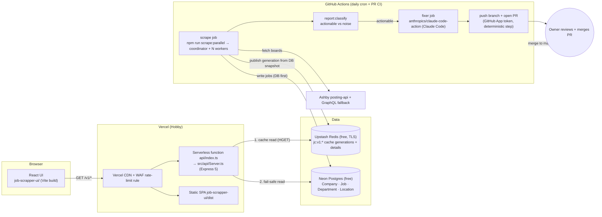
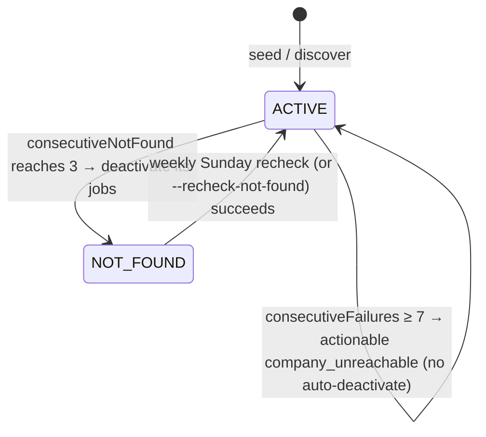
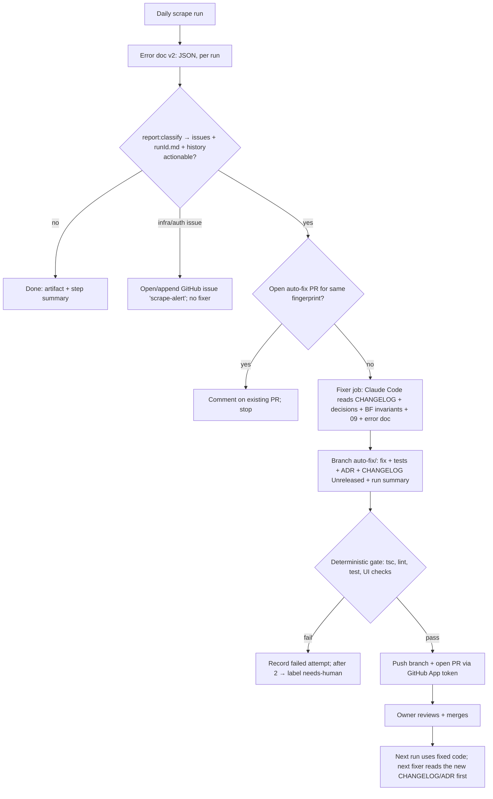

# 02 · Target Architecture

> This is the system after P1–P5 of [`12-implementation-roadmap.md`](./12-implementation-roadmap.md) are done.
> Decisions referenced as `D-nn` are listed in [`11-open-questions-and-decisions.md`](./11-open-questions-and-decisions.md).

## 1. Principles

1. **Postgres (Neon) is the source of truth.** The cache only ever holds data copied from Postgres.
2. **The scraper writes, and the API reads.** The scraper updates Postgres and then publishes a new cache generation from
   Postgres in the same run. The API reads the cache first. Postgres is its fail-safe for a cache miss, an empty or
   flushed cache, Redis being down, or the command budget being used up. The API never scrapes and **never writes to
   Redis** (D-04, 03 §5.3).
3. **A cache generation is an immutable snapshot that is swapped atomically.** Readers never see a half-written cache.
4. **Each run produces an error document, and history is kept.** Actionable issues start an automatic fix on a branch,
   which ends in a pull request. A human reviews and merges it. Agents never push to `main`.
5. **There is one source of truth for agent context.** Claude Code and Antigravity load the same canonical files
   through thin, tool-specific shells.

## 2. Component diagram



## 3. Write path: a scheduled scrape run

```mermaid
sequenceDiagram
  autonumber
  participant Cron as GH Actions cron (06:17 UTC)
  participant Co as ClusterScraper (coordinator)
  participant W as Workers ×4 (--ipc-worker)
  participant A as Ashby
  participant PG as Neon Postgres
  participant P as Publisher (src/cache/Publisher.ts)
  participant R as Upstash Redis
  participant ET as ErrorTracker v2
  Cron->>Co: npm run scrape:parallel -- --workers=4
  Co->>PG: load ACTIVE companies (+ NOT_FOUND on Sundays)
  Co->>W: fork + shard (round-robin)
  loop each company (isolated try/catch)
    W->>A: GET posting-api (retry/backoff) → GraphQL fallback on 404/403/400
    W->>PG: createMany new / upsert changed+inactive / deactivate missing (contentHash compare, no Redis)
    W->>PG: update Company counters (consecutiveNotFound/Failures, lastSuccessAt)
  end
  W-->>Co: IPC report (counters, events)
  Co->>Co: Promise.allSettled + watchdog → merge reports
  alt all workers ok
    Co->>P: publishCacheGeneration({runId, scrapeFinishedAt, prisma, redis})
    P->>R: SET jc:v1:lock:publish NX
    P->>PG: snapshot active+listed jobs (LIST_SELECT, no metadata) + facets + companies
    P->>P: sanity gate vs meta:lastPublish (gated → SET meta:lastScrapeAt only, stop, exit 2)
    P->>R: HSET jc:v1:details:<crc32(id)%8> new/changed details + jc:v1:details:index
    P->>R: HSET jc:v1:gen:<gen> pages/facets/companies/meta … then __manifest LAST; verify HLEN
    P->>R: MULTI: SET current, PERSIST new gen, SET meta:lastScrapeAt + meta:lastPublish, EXPIRE old gen 900 → EXEC
    P->>R: HDEL removed ids from details shards + index
  else a worker failed
    Note over Co,R: no publish, lastScrapeAt not updated (old generation stays live)
  end
  Co->>ET: save output/reports/<YYYY-MM>/<runId>.json (+ latest-*.json)
  Note over Co,ET: then `npm run report:classify` adds issues/diff to the JSON and writes <runId>.md (07 §2.3)
  Co-->>Cron: exit 0 (ok) | 1 (hard failure) | 2 (scrape ok, publish failed or gated)
```

## 4. Read path: the API request

```mermaid
sequenceDiagram
  autonumber
  participant B as Browser (UI)
  participant C as Vercel CDN
  participant F as API function
  participant L as In-process LRU (30 s)
  participant R as Upstash Redis
  participant PG as Neon Postgres
  B->>C: GET /v1/jobs?page=2&workplaceType=Remote
  alt CDN fresh (s-maxage 300)
    C-->>B: 200 (cached at edge)
  else
    C->>F: forward
    F->>F: canonicalJobsKey(query) → "jobs?page=2&workplaceType=Remote"; isCacheableView? (no → MISS → Postgres, no Redis)
    F->>R: MGET jc:v1:current jc:v1:meta:lastScrapeAt (only if not cached in-process; 300 s)
    F->>R: HGET jc:v1:gen:<gen> __manifest (only once per gen per instance)
    F->>L: lookup "<gen>|<key>"
    alt LRU hit
      L-->>F: body
    else
      F->>R: HGET jc:v1:gen:<gen> "jobs?page=2&workplaceType=Remote"
      alt HIT
        R-->>F: gzip body
        F-->>C: 200 X-Cache: HIT (or STALE if snapshot old)
      else MISS (view/page not cached, field missing)
        F->>PG: same query via src/api/db/queries.ts
        F-->>C: 200 X-Cache: MISS + reason
      else Redis down / timeout / breaker open / budget exceeded
        F->>PG: query
        F-->>C: 200 X-Cache: BYPASS + reason
      end
    end
  end
  Note over F,PG: Postgres down → 503 {code: UPSTREAM_UNAVAILABLE, retryAfterSeconds: 5}
```

## 5. Job lifecycle

```mermaid
stateDiagram-v2
  [*] --> Active: first seen (createMany)
  Active --> Active: unchanged (contentHash equal → no write)
  Active --> Active: changed (upsert; nullable columns cleared with null)
  Active --> Inactive: missing from a successful board fetch
  Active --> Inactive: company quarantined (3 consecutive confirmed 404s)
  Active --> PendingEmpty: board returns 0 jobs but company had ≥5 active (P1-T13)
  PendingEmpty --> Inactive: still empty next run
  PendingEmpty --> Active: jobs back
  Inactive --> Active: job reappears (contentHash compare sees active=false → upsert active=true)
```



## 6. Company lifecycle



## 7. Self-healing loop (summary; the full design is in 07)



## 8. Cross-component invariants (these become `BF-*` entries as they are implemented)

| Invariant | Owner |
|---|---|
| Postgres is written before the cache, and the cache is built only from a Postgres snapshot. | scraper / publisher |
| `jc:v1:current` is flipped only after the generation's `__manifest` has been written and verified. | publisher |
| A cache error never turns into an API error. The API serves from Postgres with `X-Cache: BYPASS`. | API |
| The fields and ordering of a list response are byte-identical whether they come from the cache or from Postgres (parity test). | API + publisher (`src/api/contract.ts`) |
| `salaryInterval` without `salaryMin` is ignored. | API + UI |
| List queries never select `metadata`. | API + publisher |
| An agent never pushes to `main` or merges. The only push is the deterministic CI step, and it pushes a branch. | loop |
| Agent context files have exactly one canonical copy; tool shells only point to it. | docs-release-keeper |

## 9. Failure-mode matrix

| Failure | Scrape behaviour | API behaviour | User sees | Alert |
|---|---|---|---|---|
| Ashby 5xx for some companies | `api_error` events, jobs kept | — | Data up to one day old for those companies | Actionable only above the R-API-1 threshold |
| A worker crashes or hangs | Watchdog kills it; report saved; exit 1; no publish | Serves the previous generation (STALE after 36 h) | Data up to one day old | Issue `scrape-alert` + fixer |
| Publish fails | Exit 2; DB is current; old generation stays | HIT on the old generation, or STALE | Data up to one day old | Step summary warning; the fixer runs only after 2 runs in a row (R-CACHE-1); no `scrape-alert` issue unless R-INFRA-1 |
| Redis down or archived | Publish fails → exit 2 | BYPASS → Postgres | Works, slightly slower | `/health` `cache.state=unreachable` |
| Command budget exhausted | Next publish may fail | Breaker opens → Postgres | Works | `/health` + report |
| Neon down | Exit 1 (R-INFRA-1) | Cache HITs still work; MISSes return 503 | Cached pages work | Issue, no fixer |
| Fixer cannot fix | Gate fails; attempt recorded | — | — | `needs-human` label after 2 attempts |
